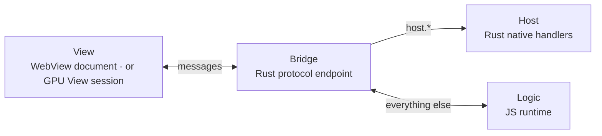

# LingXia Bridge Protocol

> **Audience**: contributors changing the bridge itself (`crates/lingxia-lxapp/src/bridge`,
> `packages/lingxia-bridge`, the GPU `gpu_page` host, platform adapters). App authors use
> `setData`, streams and channels as described in [`docs/skill/lxapp/bridge.md`](../skill/lxapp/bridge.md)
> and never build frames.

> Status: Active · Class: Normative internal specification
> Scope: Logic/Host ↔ View, over both transports

This document is the single authority for what crosses the bridge. When a draft, comment or
implementation disagrees with it, this document wins. MUST, MUST NOT, SHOULD and MAY are
normative.

## 1. Roles



| Role | Owns |
|---|---|
| Host | native capabilities, platform integration, process boundaries |
| Bridge | validation, routing, lifecycle, capability checks, direct View calls |
| Logic | page state, subscriptions, channels, JS-owned methods |
| View | rendering, user interaction, stream consumption |

Bridge is authoritative for validation and routing. State, subscriptions and channels are
produced by Logic. View is authoritative for user input. Host handlers MAY answer requests and
produce streams directly; JS is not required between Host and View.

The bridge does not define host capability semantics, business orchestration, rendering, or
transport details beyond ordered bidirectional delivery.

## 2. One protocol, two transports

Every View speaks the same message families, routing rules, capability rules and error codes
(sections 3 to 7). What differs is how a message is carried:

| Transport | View | Encoding | Security envelope |
|---|---|---|---|
| **WebView** | an HTML document in a platform WebView | JSON frames over the WebView message path | one of two profiles, section 8 |
| **GPU** | a `lingxia-view` session in the host process | typed Rust values, in process | none needed: same process, same trust |

A renderer is chosen per lxapp (`renderer` in `lxapp.json`); a page cannot pick its transport,
and neither transport can be negotiated into the other.

Today the GPU transport carries **state** typed (section 7.2) while its handshake, requests,
events and channels still travel as `v: 2` JSON frames inside the process. Typed events and
requests are the next step in [`docs/draft/gpu-bridge.md`](../draft/gpu-bridge.md); when they
land, this section is the place that records it.

## 3. Message families

| Family | Started by | Pattern | Data pushed by | Ended by |
|---|---|---|---|---|
| Notification | View | `notify` | — | — |
| Unary request | either side | `req → res` | responder | responder (`res`) |
| Streaming request | View | `req → event* → res` | Bridge (`event`) | Bridge (`res`) |
| Channel | View | `ch.open → ch.ack → ch.data* / ch.close` | both | either (`ch.close`) |
| State replication | Logic, via Bridge | `state.snapshot` / `state.patch` / `state.ack` | Bridge | — (lives with the page) |

`req`/`res` is the only symmetric family: Bridge calls View-owned handlers with the same frame
shape View uses. A streaming request is View-started, but the data flows Bridge → View.

Use state replication for durable, recoverable UI state; use `event` and `ch.data` for
transient or high-frequency payloads.

## 4. Routing and capabilities

- `host.*` methods → Host registry (unary `req` and `notify` only).
- `surface.openPage` / `surface.openUrl` `req` → Logic's `lx.surface` open with
  `{ page | url, options }`, resolving `null`. Any other `surface.*` name is
  `BRIDGE_METHOD_NOT_FOUND`, never a page method.
- Every other `req`, `notify` and `ch.open` → Logic.

`req`, `notify` and `ch.open` MUST carry `cap`, derived from the target name (`method`, or
`topic` for channels):

| Name | `cap` |
|---|---|
| `host.*` | `host` |
| `state.*` | `state` |
| `xxx.yyy` | `xxx` |
| no dot | `page` |

A mismatch MUST be rejected. `cap` is a routing-consistency check, not authentication: a
correct `cap` MUST NOT satisfy a `CallerClass`, `RouteAudience`, `AppScope` or `DocumentSession`
check. Native derives caller identity from the owning app session or the active browser
`DocumentSession`; `appid`, URL, `role`, `cap` and payload fields MUST NOT raise it.

| Backend | `req` | `notify` | `ch.open` |
|---|---|---|---|
| Host | unary and streaming | yes | — |
| Logic | unary and streaming | yes | yes |

## 5. Session

Application traffic begins after the handshake:

| Step | Direction | Purpose |
|---|---|---|
| `hello` | View → Bridge | advertise the one supported version |
| `helloAck` | Bridge → View | confirm version and session id |
| `ready` | Bridge → View | open application traffic |

```json
{ "v": 2, "kind": "hello", "nonce": "<nonce>", "role": "view", "protocolsSupported": [2] }
{ "v": 2, "kind": "helloAck", "nonce": "<nonce>", "protocol": 2, "sessionId": "<session-id>" }
{ "v": 2, "kind": "ready", "sessionId": "<session-id>" }
```

`role` names the protocol endpoint (`view`); it is neither a `CallerClass` nor a
`RouteAudience`.

Rules:

- Before `hello`, a WebView document consumes the native bootstrap exactly once: none means the
  page profile (`[2]`); a valid one pins the document-bound profile (`[3]`); a present but
  invalid one blocks the document, which then sends no frames. A profile never advertises
  `[2, 3]`.
- `helloAck` MUST match the nonce and the single required version; `ready` is ignored until a
  valid `helloAck` was accepted.
- View MUST queue application frames until `ready`; a queued operation's timeout starts when the
  frame is actually sent. Bridge MUST reject premature frames with `BRIDGE_NOT_READY`.
- The document tries the handshake at most three times, 10 s each; after that, queued requests
  and channels are rejected with `BRIDGE_HANDSHAKE_FAILED`.
- Mixed-version traffic, a wrong binding, an unsupported or future version, a stale generation,
  a subframe and an unproven transport all fail closed: none may install a connection, return
  a schema or reach route dispatch.
- Navigation, reload, renderer loss, WebView replacement and teardown MUST revoke the connection
  with its queued and in-flight work; a stale completion MUST NOT be sent over a successor.

## 6. Frames

Every frame is a JSON object with `v` (version) and `kind`. `id` is opaque to the receiver,
unique within the sender's active operations, and MUST NOT be reused before terminal
completion. `seq` starts at `0` and is monotonic per request stream or per channel direction;
receivers MUST tolerate in-flight frames arriving after `cancel` or `ch.close`. Examples use
`v: 2`; the document-bound profile sends the same payloads with `v: 3` and its envelope
(section 8.2).

### 6.1 Requests

```json
{ "v": 2, "kind": "req", "id": "<req-id>", "method": "<method>", "params": {}, "cap": "page" }
{ "v": 2, "kind": "res", "id": "<id>", "ok": true, "result": {} }
{ "v": 2, "kind": "res", "id": "<id>", "ok": false, "error": { "code": "BRIDGE_INTERNAL_ERROR", "message": "..." } }
{ "v": 2, "kind": "notify", "method": "<method>", "params": {}, "cap": "page" }
{ "v": 2, "kind": "cancel", "id": "<req-id>" }
{ "v": 2, "kind": "event", "id": "<req-or-sub-id>", "seq": 0, "payload": {} }
```

- `params` is optional; absent or `null` means no input. Bridge → View `req` MAY omit `cap`.
- `res` is terminal for a request; no `event` may follow it. For a subscription, `res`
  terminates only establishment (`{ ok: true, result: null }`), and events follow until it closes.
- `cancel` goes in the direction of the original `req` and is best effort; the initiator
  SHOULD still expect a terminal `res`, commonly `BRIDGE_CANCELED`.
- `event` is valid between dispatch and the terminal `res`; it carries transient data, not
  durable state.

### 6.2 Channels

```json
{ "v": 2, "kind": "ch.open", "id": "<channel-id>", "topic": "<topic>", "params": {}, "cap": "page" }
{ "v": 2, "kind": "ch.ack", "id": "<channel-id>", "ok": true }
{ "v": 2, "kind": "ch.ack", "id": "<channel-id>", "ok": false, "error": { "code": "BRIDGE_TOPIC_NOT_FOUND", "message": "..." } }
{ "v": 2, "kind": "ch.data", "id": "<channel-id>", "seq": 0, "payload": {} }
{ "v": 2, "kind": "ch.close", "id": "<channel-id>", "code": "done", "reason": "optional" }
```

- `ch.ack` completes establishment; after `ok: false` no `ch.data` or `ch.close` is valid for
  that id.
- `ch.data` and `ch.close` flow both ways; after sending `ch.close` the sender MUST stop sending
  `ch.data` on that id.

### 6.3 State

```json
{ "v": 2, "kind": "state.snapshot", "scope": "page", "rev": 1, "state": {} }
{ "v": 2, "kind": "state.patch", "scope": "page", "baseRev": 1, "rev": 2, "ops": [], "ack": true }
{ "v": 2, "kind": "state.ack", "scope": "page", "rev": 2 }
```

Semantics are in section 7. These frames exist on the WebView transport only.

## 7. State replication

Logic owns page `data`; `setData` produces revisions that Bridge delivers to the View. Each
revision is a JSON Patch (`ops`) on the previous one, or a full snapshot. View applies in order
and acknowledges; an acknowledgement resolves `await page.flush()` in Logic for every write up to
that revision.

### 7.1 WebView transport

- View subscribes once (`LingXiaBridge.state.subscribe`) and receives `state.snapshot` then
  `state.patch` frames without requesting them.
- A patch whose `baseRev` is not the View's current revision is a gap; the View requests a
  snapshot (`state.getSnapshot`) and discards patches until it arrives.
- `state.ack` is sent after the DOM apply. Logic batches writes in a 16 ms window, so one frame
  is one DOM apply.

### 7.2 GPU transport

State never becomes a frame. Logic parses `setData` ops once into typed `PatchOp`s and posts a
`StateWrite` (`Snapshot { rev, state }` or `Patch { rev, ops, ack }`) from the Logic thread to
the View worker through the facade's `gpu_page` host. The View replica applies ops in place and
reports back a `StateSignal`:

- `Acked(rev)`: the frame built from `rev` is committed for display (prepared and queued for the
  next vsync), or no frame will ever show it. Acks leave in write order. A page not in the stack
  acknowledges at once; a showing page whose window is covered acknowledges per paced frame; a
  write no frame can show is acknowledged after 250 ms.
- `Resync`: a patch was not newer than the current revision or an op failed; Logic sends a
  snapshot and the View drops writes until it arrives.

There is no `baseRev`, no `state.getSnapshot` and no batch window: writes of one Logic task
coalesce and leave when the task ends. Adapters (`lingxia-view-{android,apple,harmony}`) carry
no state at all.

## 8. WebView transport

### 8.1 Profiles

Native selects the profile for a document; the page can neither choose nor negotiate down.

| Profile | `v` | Used by | Selected when | Authority |
|---|---|---|---|---|
| **Page profile** | 2 | every ordinary lxapp page document | no control bootstrap is installed | identity comes from the native page owner; a frame is not a credential |
| **Document-bound profile** | 3 | host-attested browser control documents | native bootstrap pins `requiredProtocol: 3` for one committed document | every frame is bound to that document's active `DocumentSession` |

In code these are `BridgeProtocol::LegacyV2` and `BridgeProtocol::BoundV3`. An ordinary page
stays on the page profile even though V3 exists in the same process; a control document stays
document-bound, and a missing, malformed, V2 or future-version bootstrap or frame MUST NOT
degrade it.

### 8.2 Document-bound envelope

The V3 codec owns the security fields. Callers pass family payloads only; a payload carrying
`v`, `kind`, `sessionId` or `secret` MUST be rejected and MUST NOT override the envelope.

| Direction | Families | Envelope |
|---|---|---|
| document → native | `hello`, `req`, `res`, `notify`, `cancel`, `ch.open`, `ch.data`, `ch.close`, `state.ack` | `v: 3`, exact `kind`, current public `sessionId`, document secret |
| native → document | `helloAck`, `ready`, `req`, `res`, `event`, `state.snapshot`, `state.patch`, `ch.ack`, `ch.data`, `ch.close` | `v: 3`, exact `kind`, current public `sessionId`; `secret` MUST be absent |

Before decoding a payload or looking up a route, native MUST validate frame size, version,
direction/kind, native WebView identity, the committed `DocumentGeneration`, top-level proof,
transport, public session id and secret. Before delivery, the document MUST validate version,
direction/kind and session id. A duplicate top-level security key is malformed. The secret is
captured only by the one-shot bootstrap codec and MUST NOT be copied into runtime config, logged,
or sent native → document. Every V3 `helloAck` and later native frame MUST match the current
public `sessionId`.

The console sideband is no exception: a control-document console envelope carries `v: 3`,
`kind: "console"`, `sessionId` and `secret`, and passes the same checks before its separately
rate-limited log path.

### 8.3 Bounds, queues, rate limits

These are a fail-closed ingress contract, not tuning hints.

| Bound | Limit | On exceeding it |
|---|---:|---|
| single native WebView message | 64 KiB | rejected before any LingXia payload is materialized where the adapter can read the raw length; on every platform no later than enqueue |
| WebView ingress queue | 1,024 frames, 1 MiB | new frames rejected; accepted frames keep FIFO order |
| V3 predecode frame | 64 KiB | rejected before a typed payload is allocated |
| `sessionId` or `secret` probe field | 512 bytes | rejected as malformed |
| document pre-ready outbox | 256 frames | operation rejected with `BRIDGE_OUTBOX_FULL` |
| console sideband | 32 messages per second | excess dropped, `console_rate_limited` diagnostic |

The document enforces the message bound before posting: it rejects the operation with
`BRIDGE_MESSAGE_TOO_LARGE` instead of letting native drop the frame silently.

Ingress is one bounded FIFO dispatcher, never a thread per message. After close, new frames are
rejected and unadmitted queued frames are discarded. Rejections are counted by reason; logs are
sampled at counts 1 and powers of 2, and a diagnostic MUST NOT contain the frame, URL, session id
or secret.

The outer cap does not depend on JSON or typed decode. Apple accepts only an `NSString` body and
checks its UTF-8 length before copying into Rust. Android computes the UTF-8 length from the Java
UTF-16 string at both entries (`MessagePort`, API 21/22 `JavascriptInterface`) before crossing
JNI. HarmonyOS uses ArkWeb's `data_length` on both ports. WebView2 hands Windows an `HSTRING`
already, so Windows applies the same 64 KiB rejection before the queue and V3 decode; this is not
an authority downgrade.

### 8.4 Platform provenance

| Platform | Document-bound proof | When it cannot be proven |
|---|---|---|
| Apple | current native WebView, committed generation, top-level `WKScriptMessage` frame proof | fail closed |
| Android API 23+ | host-issued load token correlated with commit, then a fresh per-document `MessagePort` | stale, external and reused ports rejected; navigation, reload, crash and teardown close the port |
| Android API 21/22 | none; `JavascriptInterface` is always `Unproven` | rendering continues, BrowserControl unavailable (`android_api_below_23` / `android_21_22_unproven_transport`) |
| Windows | WebView2 navigation identity plus current top-level document/generation proof | fail closed on stale, frame or source mismatch |
| HarmonyOS | host-issued trusted load intent and non-reused native key correlated with the ArkTS page epoch across start and commit, then a fresh per-document port bound to WebView, generation, port and callback token | stale, external or reused port, reload, renderer loss or teardown revokes the binding, fail closed |

Page-profile delivery MAY keep its platform fallbacks. Document-bound output goes through the
platform's generation-aware send path and MUST NOT degrade to a bare string or an
`evaluateJavascript` send.

### 8.5 Restoration and renderer loss

History and BFCache can restore old HTML with old credentials without re-entering the host
loader. If an internal document's commit does not match the current trusted start, native MUST
keep it unauthenticated, detach the old page lifecycle and schedule a fresh trusted load; a new
session exists only once the fresh load's `NavigationId`, generation, attestation, secret and
public `sessionId` all match. Restored frames and stale reload completions MUST NOT reach the
successor.

Renderer termination MUST clear the committed generation before notifying upper layers or
reloading. Navigation, reload, crash and teardown revoke the old port and session on every
backend. An external history entry may present normally but never gains BrowserControl
authority.

## 9. GPU transport

- The View session lives on the host's render thread; the facade's `gpu_page` host owns the
  channel to it. Nothing crosses a WebView, so no envelope, size cap or provenance proof applies.
- State: typed, section 7.2.
- Handshake, requests, events, channels: `v: 2` frames handed to the session as strings
  (`NativePage::receive`); the session rejects any other version. Replacing these with typed
  values is the remaining step of the GPU bridge redesign.
- Hot swap and automation keep their own entry points; they are not on the per-frame path.

## 10. Error codes

Codes are part of the contract and MUST NOT be removed or redefined.

| Code | Meaning |
|---|---|
| `BRIDGE_NOT_READY` | handshake not complete |
| `BRIDGE_TIMEOUT` | request timed out |
| `BRIDGE_CANCELED` | request or stream canceled |
| `BRIDGE_PROTOCOL_MISMATCH` | unsupported protocol version |
| `BRIDGE_HANDSHAKE_FAILED` | handshake failed |
| `BRIDGE_MALFORMED_MESSAGE` | invalid frame |
| `BRIDGE_MESSAGE_TOO_LARGE` | frame over the message bound, rejected by the sender |
| `BRIDGE_METHOD_NOT_FOUND` | request method missing |
| `BRIDGE_TOPIC_NOT_FOUND` | channel topic missing |
| `BRIDGE_CAPABILITY_DENIED` | capability denied |
| `BRIDGE_INTERNAL_ERROR` | unexpected internal error |
| `BRIDGE_OUTBOX_FULL` | sender outbox overflow |
| `BRIDGE_STREAM_OVERFLOW` | stream buffer overflow |
| `BRIDGE_STREAM_CLOSED` | operation on a closed stream or channel |

## 11. JS API mapping

Low-level, one call per frame family; used by generated page-action runtimes:

```ts
LingXiaBridge.raw.call(method, params?, options?): Promise<result>
LingXiaBridge.raw.stream(method, params?, options?): StreamHandle<data, result>
LingXiaBridge.raw.notify(method, params?, options?): void
LingXiaBridge.raw.channel.open(topic, params?, options?): Promise<Channel<data>>
LingXiaBridge.state.subscribe((data, info) => void): () => void
```

Host convenience, not a protocol primitive: prefixes `host.`, sets `cap: "host"`, normalizes
errors, wraps handles:

```ts
LingXiaBridge.invoke(route, input?, options?): Promise<result>
LingXiaBridge.stream(route, input?, options?): NativeStream<data, result>
LingXiaBridge.notify(route, input?, options?): void
LingXiaBridge.channel(route, input?, options?): Promise<NativeChannel<in, out>>
```

Generated page actions:

| JS method shape | View call |
|---|---|
| `void`, `Promise<void>`, or a non-void return | `raw.call()`, settles when the action settles |
| `async function*`, `AsyncIterable`, `AsyncIterator`, `AsyncGenerator` | `raw.stream()` |

A unary action has no bridge deadline (`timeoutMs: 0`): Logic settles it, a transport reset
rejects it, a departing document takes it along. A call made before the page's first state
(native components fire early) is held; one the host answers `BRIDGE_NOT_READY` after that is
dropped unsettled, because that document's session has ended. Logic runs each `req` as its own
context task, never on the worker's message pump: an action may await work that only a later
message drives, so awaiting it inline would deadlock Logic.
