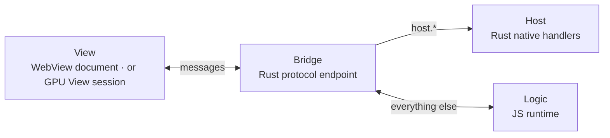

# LingXia Bridge Protocol

> **Audience**: contributors changing the bridge itself (`crates/lingxia-lxapp/src/bridge`,
> `packages/lingxia-bridge`, the GPU `gpu_page` host, platform adapters). App authors use
> `setData`, streams and channels as described in [`docs/skill/lxapp/bridge.md`](../skill/lxapp/bridge.md)
> and never build frames.

> Scope: Logic/Host ↔ View, over both transports

This document is the single authority for what crosses the bridge. When a draft, comment or
implementation disagrees with it, this document wins. MUST, MUST NOT, SHOULD and MAY are
normative.

## 1. Roles



| Role | Owns |
|---|---|
| Host | native capabilities, platform integration, process boundaries |
| Bridge | validation, routing, lifecycle, capability checks, direct View calls |
| Logic | page state, subscriptions, channels, JS-owned methods |
| View | rendering, user interaction, stream consumption |

Bridge is authoritative for validation and routing. State, subscriptions and channels are
produced by Logic. View is authoritative for user input. Host handlers MAY answer requests and
produce streams directly; JS is not required between Host and View.

The bridge does not define host capability semantics, business orchestration, rendering, or
transport details beyond ordered bidirectional delivery.

## 2. One protocol, two transports

Every View speaks the same message families, routing rules, capability rules and error codes
(sections 3 to 7). What differs is how a message is carried:

| Transport | View | Encoding | Security envelope |
|---|---|---|---|
| **WebView** | an HTML document in a platform WebView | JSON frames over the WebView message path | none on the frame; native page ownership and platform provenance, section 8 |
| **GPU** | a `lingxia-view` session in the host process | typed Rust values, in process | none needed: same process, same trust |

A renderer is chosen per lxapp (`renderer` in the built `lxapp.json`, which the CLI derives from the pages' exports); a page cannot pick its transport,
and neither transport can be negotiated into the other.

The GPU transport is fully typed: state, requests, replies, events, streams and channels cross
as Rust values walked to and from the engines, with no JSON text and no frame in either
direction. It has no handshake frames; the connection generation and endpoint identity carry
the trust the handshake and document generation establish on the WebView path.

## 3. Message families

| Family | Started by | Pattern | Data pushed by | Ended by |
|---|---|---|---|---|
| Notification | View | `notify` | — | — |
| Unary request | either side | `req → res` | responder | responder (`res`) |
| Streaming request | View | `req → event* → res` | Bridge (`event`) | Bridge (`res`) |
| Channel | View | `ch.open → ch.ack → ch.data* / ch.close` | both | either (`ch.close`) |
| State replication | Logic, via Bridge | `state.snapshot` / `state.patch` / `state.ack` | Bridge | — (lives with the page) |

`req`/`res` is the only symmetric family: Bridge calls View-owned handlers with the same frame
shape View uses. A streaming request is View-started, but the data flows Bridge → View.

Use state replication for durable, recoverable UI state; use `event` and `ch.data` for
transient or high-frequency payloads.

## 4. Routing and capabilities

- `host.*` methods → Host registry (unary `req` and `notify` only).
- `surface.openPage` / `surface.openUrl` `req` → Logic's `lx.surface` open with
  `{ page | url, options }`, resolving `null`. Any other `surface.*` name is
  `BRIDGE_METHOD_NOT_FOUND`, never a page method.
- Every other `req`, `notify` and `ch.open` → Logic.

`req`, `notify` and `ch.open` MUST carry `cap`, derived from the target name (`method`, or
`topic` for channels):

| Name | `cap` |
|---|---|
| `host.*` | `host` |
| `state.*` | `state` |
| `xxx.yyy` | `xxx` |
| no dot | `page` |

A mismatch MUST be rejected. `cap` is a routing-consistency check, not authentication: a
correct `cap` MUST NOT satisfy a `CallerClass`, `RouteAudience` or `AppScope` check. Native
derives caller identity from the owning lxapp session only; `appid`, URL, `role`, `cap` and
payload fields MUST NOT raise it.

| Backend | `req` | `notify` | `ch.open` |
|---|---|---|---|
| Host | unary and streaming | yes | — |
| Logic | unary and streaming | yes | yes |

## 5. Session

Application traffic begins after the handshake (WebView; a GPU View connects as section 9
says):

| Step | Direction | Purpose |
|---|---|---|
| `hello` | View → Bridge | advertise the one supported version |
| `helloAck` | Bridge → View | confirm version and session id |
| `ready` | Bridge → View | open application traffic |

```json
{ "v": 2, "kind": "hello", "nonce": "<nonce>", "role": "view", "protocolsSupported": [2] }
{ "v": 2, "kind": "helloAck", "nonce": "<nonce>", "protocol": 2, "sessionId": "<session-id>" }
{ "v": 2, "kind": "ready", "sessionId": "<session-id>" }
```

`role` names the protocol endpoint (`view`); it is neither a `CallerClass` nor a
`RouteAudience`.

Rules:

- `hello` advertises exactly `[2]`; any other version fails closed before a typed message is
  built.
- `helloAck` MUST match the nonce and version 2; `ready` is ignored until a valid `helloAck`
  was accepted.
- View MUST queue application frames until `ready`; a queued operation's timeout starts when the
  frame is actually sent. Bridge MUST reject premature frames with `BRIDGE_NOT_READY`.
- The document tries the handshake at most three times, 10 s each; after that, queued requests
  and channels are rejected with `BRIDGE_HANDSHAKE_FAILED`.
- An unsupported or future version, a stale generation, a subframe and an unproven transport
  all fail closed: none may install a connection, return
  a schema or reach route dispatch.
- Navigation, reload, renderer loss, WebView replacement and teardown MUST revoke the connection
  with its queued and in-flight work; a stale completion MUST NOT be sent over a successor.

## 6. Frames

Every frame is a JSON object with `v` (version) and `kind`. `id` is opaque to the receiver,
unique within the sender's active operations, and MUST NOT be reused before terminal
completion. `seq` starts at `0` and is monotonic per request stream or per channel direction;
receivers MUST tolerate in-flight frames arriving after `cancel` or `ch.close`. Every WebView
frame carries `v: 2`.

### 6.1 Requests

```json
{ "v": 2, "kind": "req", "id": "<req-id>", "method": "<method>", "params": {}, "cap": "page" }
{ "v": 2, "kind": "res", "id": "<id>", "ok": true, "result": {} }
{ "v": 2, "kind": "res", "id": "<id>", "ok": false, "error": { "code": "BRIDGE_INTERNAL_ERROR", "message": "..." } }
{ "v": 2, "kind": "notify", "method": "<method>", "params": {}, "cap": "page" }
{ "v": 2, "kind": "cancel", "id": "<req-id>" }
{ "v": 2, "kind": "event", "id": "<req-or-sub-id>", "seq": 0, "payload": {} }
```

- `params` is optional; absent or `null` means no input. Bridge → View `req` MAY omit `cap`.
- `res` is terminal for a request; no `event` may follow it. For a subscription, `res`
  terminates only establishment (`{ ok: true, result: null }`), and events follow until it closes.
- `cancel` goes in the direction of the original `req` and is best effort; the initiator
  SHOULD still expect a terminal `res`, commonly `BRIDGE_CANCELED`.
- `event` is valid between dispatch and the terminal `res`; it carries transient data, not
  durable state.

### 6.2 Channels

```json
{ "v": 2, "kind": "ch.open", "id": "<channel-id>", "topic": "<topic>", "params": {}, "cap": "page" }
{ "v": 2, "kind": "ch.ack", "id": "<channel-id>", "ok": true }
{ "v": 2, "kind": "ch.ack", "id": "<channel-id>", "ok": false, "error": { "code": "BRIDGE_TOPIC_NOT_FOUND", "message": "..." } }
{ "v": 2, "kind": "ch.data", "id": "<channel-id>", "seq": 0, "payload": {} }
{ "v": 2, "kind": "ch.close", "id": "<channel-id>", "code": "done", "reason": "optional" }
```

- `ch.ack` completes establishment; after `ok: false` no `ch.data` or `ch.close` is valid for
  that id.
- `ch.data` and `ch.close` flow both ways; after sending `ch.close` the sender MUST stop sending
  `ch.data` on that id.

### 6.3 State

```json
{ "v": 2, "kind": "state.snapshot", "scope": "page", "rev": 1, "state": {} }
{ "v": 2, "kind": "state.patch", "scope": "page", "baseRev": 1, "rev": 2, "ops": [], "ack": true }
{ "v": 2, "kind": "state.ack", "scope": "page", "rev": 2 }
```

Semantics are in section 7. These frames exist on the WebView transport only.

## 7. State replication

Logic owns page `data`; `setData` produces revisions that Bridge delivers to the View. Each
revision is a JSON Patch (`ops`) on the previous one, or a full snapshot. View applies in order
and acknowledges; an acknowledgement resolves `await page.flush()` in Logic for every write up to
that revision.

### 7.1 WebView transport

- View subscribes once (`LingXiaBridge.state.subscribe`) and receives `state.snapshot` then
  `state.patch` frames without requesting them.
- A patch whose `baseRev` is not the View's current revision is a gap; the View requests a
  snapshot (`state.getSnapshot`) and discards patches until it arrives.
- `state.ack` is sent after the DOM apply. Logic batches writes in a 16 ms window, so one frame
  is one DOM apply.

### 7.2 GPU transport

State never becomes a frame. Logic parses `setData` ops once into typed `PatchOp`s and posts a
`StateWrite` (`Snapshot { rev, state }` or `Patch { rev, ops, ack }`) from the Logic thread to
the View worker through the facade's `gpu_page` host. The View replica applies ops in place and
reports back a `StateSignal`:

- `Acked(rev)`: the frame built from `rev` is committed for display (prepared and queued for the
  next vsync), or no frame will ever show it. Acks leave in write order. A page not in the stack
  acknowledges at once; a showing page whose window is covered acknowledges per paced frame; a
  write no frame can show is acknowledged after 250 ms.
- `Resync`: a patch was not newer than the current revision or an op failed; Logic sends a
  snapshot and the View drops writes until it arrives.

There is no `baseRev`, no `state.getSnapshot` and no batch window: writes of one Logic task
coalesce and leave when the task ends. Adapters (`lingxia-view-{android,apple,harmony}`) carry
no state at all.

The View isolate keeps its own frozen copy of `data` and, before a render, replays the ops
journaled since its last frame, so a frame costs the change; a snapshot, a resync, a long journal
or a fresh isolate takes the whole tree. Renders are paced by vsync (writes between two vsyncs
cost one render), and `flush()` resolves on `Acked`, one refresh before the frame is on screen.

## 8. WebView transport

### 8.1 Page ownership

Every WebView document speaks `v: 2`. Identity comes from the native page that owns the
WebView; a frame is not a credential, and the page can neither choose nor raise it.

### 8.2 Bounds, queues, rate limits

These are a fail-closed ingress contract, not tuning hints.

| Bound | Limit | On exceeding it |
|---|---:|---|
| single native WebView message | 64 KiB | rejected before any LingXia payload is materialized where the adapter can read the raw length; on every platform no later than enqueue |
| WebView ingress queue | 1,024 frames, 1 MiB | new frames rejected; accepted frames keep FIFO order |
| document pre-ready outbox | 256 frames | operation rejected with `BRIDGE_OUTBOX_FULL` |

The document enforces the message bound before posting: it rejects the operation with
`BRIDGE_MESSAGE_TOO_LARGE` instead of letting native drop the frame silently.

Ingress is one bounded FIFO dispatcher, never a thread per message. After close, new frames are
rejected and unadmitted queued frames are discarded. Rejections are counted by reason; logs are
sampled at counts 1 and powers of 2, and a diagnostic MUST NOT contain the frame, URL or
session id.

The outer cap does not depend on JSON or typed decode. Apple accepts only an `NSString` body and
checks its UTF-8 length before copying into Rust. Android computes the UTF-8 length from the Java
UTF-16 string at both entries (`MessagePort`, API 21/22 `JavascriptInterface`) before crossing
JNI. HarmonyOS uses ArkWeb's `data_length` on both ports. WebView2 hands Windows an `HSTRING`
already, so Windows applies the same 64 KiB rejection before the queue and decode.

### 8.3 Platform provenance

A message's `WebMessageContext` carries the committed `DocumentGeneration` and frame proof the
adapter could establish. A frame is not a credential; the context only lets generation-bound
output and stale-delivery checks fail closed.

| Platform | Top-level document proof | When it cannot be proven |
|---|---|---|
| Apple | current native WebView, committed generation, top-level `WKScriptMessage` frame proof | subframe or stale generation, never bound |
| Android API 23+ | native load token correlated with the visible commit, then a fresh per-document `MessagePort` (not minted for the browser profile) | stale and reused ports rejected; navigation, reload, crash and teardown close the port |
| Android API 21/22 | none; `JavascriptInterface` is always `Unproven` | pages render without document proof |
| Windows | WebView2 navigation identity plus current top-level document/generation | stale, frame or source mismatch, never bound |
| HarmonyOS | non-reused native key correlated with the ArkTS page epoch across begin and commit, then a fresh per-document port bound to WebView, generation, port and callback token | stale or reused port, reload, renderer loss or teardown revokes the binding |

Unbound delivery MAY keep its platform fallbacks. Generation-bound output goes through the
platform's generation-aware send path and MUST NOT degrade to a bare string or an
`evaluateJavascript` send.

### 8.4 Restoration and renderer loss

History and BFCache can restore an old document without a fresh start and commit. Where a
backend sees that — Apple `pageshow.persisted`, WebView2 `SourceChanged.IsNewDocument` over a
still-bound document, a second ArkWeb visible commit for one begin — native MUST clear the
committed generation. The restored document stays unbound until a fresh navigation commits.

Renderer termination MUST clear the committed generation before notifying upper layers or
reloading. Navigation, reload, crash and teardown revoke the old port on every backend.

## 9. GPU transport

- The View session lives on the host's render thread; the facade's `gpu_page` host owns the
  channel to it. Nothing crosses a WebView, so no envelope, size cap or provenance proof applies.
- State: typed, section 7.2. `setData` ops, snapshots and the replica's sync into the View
  isolate are walked through the engines, never serialized.
- Connection: Logic binds a generation and calls `connect(generation)`; the View resets, arms its
  actions and answers `Connected` from its worker, which marks the bridge ready and starts Logic.
  No hello, helloAck, ready or nonce: every message after that is admitted only for the current
  endpoint and generation, checked again at delivery.
- View → Logic (`GpuViewEvent`): calls, cancels, channel open/data/close and replies, sent from
  the View worker straight to Logic's queue.
- Logic → View (`GpuViewMessage`): replies, stream events, channel acks/data/close and requests,
  applied on the View worker in order with state writes.
- Requests are `GpuViewRequest`, one nested enum per family (`Ui`, `Video`) answered by id. A new
  family is one variant with its `from_call` arm and a View handler; the transport is unchanged.
- Hot swap and automation keep their own entry points; they are not on the per-frame path.

## 10. Error codes

Codes are part of the contract and MUST NOT be removed or redefined.

| Code | Meaning |
|---|---|
| `BRIDGE_NOT_READY` | handshake not complete |
| `BRIDGE_TIMEOUT` | request timed out |
| `BRIDGE_CANCELED` | request or stream canceled |
| `BRIDGE_PROTOCOL_MISMATCH` | unsupported protocol version |
| `BRIDGE_HANDSHAKE_FAILED` | handshake failed |
| `BRIDGE_MALFORMED_MESSAGE` | invalid frame |
| `BRIDGE_MESSAGE_TOO_LARGE` | frame over the message bound, rejected by the sender |
| `BRIDGE_METHOD_NOT_FOUND` | request method missing |
| `BRIDGE_TOPIC_NOT_FOUND` | channel topic missing |
| `BRIDGE_CAPABILITY_DENIED` | capability denied |
| `BRIDGE_INTERNAL_ERROR` | unexpected internal error |
| `BRIDGE_OUTBOX_FULL` | sender outbox overflow |
| `BRIDGE_STREAM_OVERFLOW` | stream buffer overflow |
| `BRIDGE_STREAM_CLOSED` | operation on a closed stream or channel |

## 11. JS API mapping

Low-level, one call per frame family; used by generated page-action runtimes:

```ts
LingXiaBridge.raw.call(method, params?, options?): Promise<result>
LingXiaBridge.raw.stream(method, params?, options?): StreamHandle<data, result>
LingXiaBridge.raw.notify(method, params?, options?): void
LingXiaBridge.raw.channel.open(topic, params?, options?): Promise<Channel<data>>
LingXiaBridge.state.subscribe((data, info) => void): () => void
```

Host convenience, not a protocol primitive: prefixes `host.`, sets `cap: "host"`, normalizes
errors, wraps handles:

```ts
LingXiaBridge.invoke(route, input?, options?): Promise<result>
LingXiaBridge.stream(route, input?, options?): NativeStream<data, result>
LingXiaBridge.notify(route, input?, options?): void
LingXiaBridge.channel(route, input?, options?): Promise<NativeChannel<in, out>>
```

Generated page actions:

| JS method shape | View call |
|---|---|
| `void`, `Promise<void>`, or a non-void return | `raw.call()`, settles when the action settles |
| `async function*`, `AsyncIterable`, `AsyncIterator`, `AsyncGenerator` | `raw.stream()` |

A unary action has no bridge deadline (`timeoutMs: 0`): Logic settles it, a transport reset
rejects it, a departing document takes it along. A call made before the page's first state
(native components fire early) is held; one the host answers `BRIDGE_NOT_READY` after that is
dropped unsettled, because that document's session has ended. Logic runs each `req` as its own
context task, never on the worker's message pump: an action may await work that only a later
message drives, so awaiting it inline would deadlock Logic.
