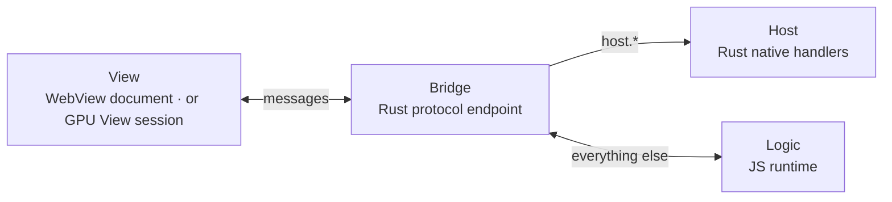

# LingXia Bridge Protocol

> **Audience**: framework developers and maintainers working on the Logic/Host ↔ View bridge.
> App-author usage (`setData`, streams, channels) lives in
> [`docs/skill/lxapp/bridge.md`](../skill/lxapp/bridge.md).

This document is the normative protocol specification for everything that crosses the bridge.
When a comment or implementation disagrees with it, this document wins. `MUST`, `MUST NOT`,
`SHOULD`, and `MAY` are normative.

## 1. Roles



| Role | Owns |
| --- | --- |
| **Host** | native capabilities, platform integration, process boundaries |
| **Bridge** | validation, routing, lifecycle, capability checks, direct View calls |
| **Logic** | page state, subscriptions, channels, JS-owned methods |
| **View** | rendering, user interaction, stream consumption |

Bridge is authoritative for validation and routing. State, subscriptions, and channels are
produced by Logic. View is authoritative for user input. Host handlers MAY answer requests and
produce streams directly; JS is not required between Host and View. A GPU View reaches Host
directly only for the navigation allowlist in section 4.

---

## 2. One Protocol, Two Transports

Every View speaks the same message families, routing rules, capability checks, and error codes
(sections 3 to 7), except that a GPU View's direct `host.*` calls are limited to an allowlist
(section 4). Otherwise only the transport encoding differs:

| Transport | View | Encoding | Trust Boundary |
| --- | --- | --- | --- |
| **WebView** | HTML document in a platform WebView | JSON frames over WebView messaging | Native page ownership + platform document provenance (section 8) |
| **GPU** | In-process GPU View session | Typed in-process messages (no JSON frames) | Same process; endpoint identity + connection generation (section 9) |

The renderer is fixed per lxapp at build time; a page cannot choose or negotiate its transport.

---

## 3. Message Families

| Family | Started by | Pattern | Data pushed by | Ended by |
| --- | --- | --- | --- | --- |
| **Notification** | View | `notify` | — | — |
| **Unary request** | either side | `req → res` | responder | responder (`res`) |
| **Streaming request** | View | `req → event* → res` | Bridge (`event`) | Bridge (`res`) |
| **Channel** | View | `ch.open → ch.ack → ch.data* / ch.close` | both | either (`ch.close`) |
| **State replication** | Logic, via Bridge | `state.snapshot` / `state.patch` / `state.ack` | Bridge | — (lives with the page) |

`req`/`res` is the only symmetric family (Bridge invokes View-owned handlers with the same shape).
Use state replication for durable, recoverable UI state; use `event` and `ch.data` for transient or
high-frequency payloads.

---

## 4. Routing and Capabilities

- `host.*` methods → Host registry (unary and streaming `req`, `notify`, and `ch.open`). From a
  GPU View only `host.navigation.setLeaveGuard`, `host.navigation.leave`, and
  `host.navigation.setTitle` go to Host directly; every other `host.*` call is rejected with
  `E_PERMISSION_DENIED` and must go through a Logic action.
- `surface.openPage` / `surface.openUrl` `req` → Logic's surface open, resolving `null`. Any other
  `surface.*` name returns `BRIDGE_METHOD_NOT_FOUND`, never a page method.
- `nav.go` `req` → Logic's navigation for the calling page, resolving `null`; a target that is not
  an object fails with `BRIDGE_MALFORMED_MESSAGE`.
- Every other `req`, `notify`, and `ch.open` → Logic.

Every View-originated `req`, `notify`, and `ch.open` MUST carry `cap`, derived from the target
name (`method`, or `topic` for channels):

| Target name | `cap` |
| --- | --- |
| `host.*` | `host` |
| `state.*` | `state` |
| `xxx.yyy` | `xxx` |
| no dot | `page` |

A mismatch MUST be rejected. `cap` is a routing-consistency check, **not** authentication: a
correct `cap` MUST NOT satisfy a `CallerClass`, `RouteAudience`, or `AppScope` check. Native
derives caller identity exclusively from the owning lxapp session; `appid`, URL, `role`, `cap`, and
payload fields MUST NOT raise it.

---

## 5. Session Handshake (WebView)

Application traffic on WebView pages begins only after the v2 handshake (GPU Views connect
in-process as described in section 9):

| Step | Direction | Purpose |
| --- | --- | --- |
| `hello` | View → Bridge | advertise supported version (`[2]`) |
| `helloAck` | Bridge → View | confirm version `2` and session id |
| `ready` | Bridge → View | open application traffic |

```json
{ "v": 2, "kind": "hello", "nonce": "<nonce>", "role": "view", "protocolsSupported": [2] }
{ "v": 2, "kind": "helloAck", "nonce": "<nonce>", "protocol": 2, "sessionId": "<session-id>" }
{ "v": 2, "kind": "ready", "sessionId": "<session-id>" }
```

Normative rules:

- `hello` MUST advertise `[2]`; any other version fails closed before typed decoding.
- `helloAck` MUST match the nonce and version `2`; `ready` is ignored until a valid `helloAck` is
  accepted.
- View MUST queue application frames until `ready` (operation timeouts start on actual send);
  Bridge MUST reject premature frames with `BRIDGE_NOT_READY`.
- Handshake retries at most 3 times (10 s each); after failure, queued work rejects with
  `BRIDGE_HANDSHAKE_FAILED`.
- Unsupported versions, stale generations, subframes, and unproven transports fail closed and MUST
  NOT install a connection or reach dispatch.
- Navigation, reload, renderer loss, WebView replacement, and teardown MUST revoke the connection
  and its in-flight work; stale completions MUST NOT be delivered to a successor session.

---

## 6. Wire Frames (WebView, `v: 2`)

Every frame is a JSON object carrying `v: 2` and `kind`. `id` is opaque, unique among active
operations of the sender, and MUST NOT be reused before terminal completion. `seq` starts at `0`
and is monotonic per stream or channel direction; receivers MUST tolerate in-flight frames arriving
after `cancel` or `ch.close`.

### Requests
```json
{ "v": 2, "kind": "req", "id": "<req-id>", "method": "<method>", "params": {}, "cap": "page" }
{ "v": 2, "kind": "res", "id": "<id>", "ok": true, "result": {} }
{ "v": 2, "kind": "res", "id": "<id>", "ok": false, "error": { "code": "E_NOT_FOUND", "message": "...", "reason": "optional", "data": {} } }
{ "v": 2, "kind": "notify", "method": "<method>", "params": {}, "cap": "page" }
{ "v": 2, "kind": "cancel", "id": "<req-id>" }
{ "v": 2, "kind": "event", "id": "<req-or-sub-id>", "seq": 0, "payload": {} }
```
- `res` is terminal for unary/streaming requests (no `event` may follow). For subscriptions, `res`
  confirms establishment and events follow until close.
- `cancel` is best-effort; the initiator SHOULD still expect a terminal `res` (commonly
  `E_ABORT`).
- A failed `res` carries `{ code, message, reason?, data? }`: `code` is always a string, `message`
  is English for a log, `reason` names the business case. Numeric codes never reach the wire.

### Channels
```json
{ "v": 2, "kind": "ch.open", "id": "<channel-id>", "topic": "<topic>", "params": {}, "cap": "page" }
{ "v": 2, "kind": "ch.ack", "id": "<channel-id>", "ok": true }
{ "v": 2, "kind": "ch.ack", "id": "<channel-id>", "ok": false, "error": { "code": "BRIDGE_TOPIC_NOT_FOUND", "message": "..." } }
{ "v": 2, "kind": "ch.data", "id": "<channel-id>", "seq": 0, "payload": {} }
{ "v": 2, "kind": "ch.close", "id": "<channel-id>", "code": "done", "reason": "optional" }
```
- After `ch.ack` with `ok: false`, no `ch.data` or `ch.close` is valid for that id.
- After sending `ch.close`, the sender MUST stop sending `ch.data` on that id.

### State (WebView only)
```json
{ "v": 2, "kind": "state.snapshot", "scope": "page", "rev": 1, "state": {} }
{ "v": 2, "kind": "state.patch", "scope": "page", "baseRev": 1, "rev": 2, "ops": [], "ack": true }
{ "v": 2, "kind": "state.ack", "scope": "page", "rev": 2 }
```

---

## 7. State Replication Semantics

Logic owns page `data`. Writes produce monotonic revisions delivered as JSON Patches or full
snapshots. View applies in order and acknowledges; acknowledgement resolves `await page.flush()`
in Logic for all writes up to that revision.

- **WebView transport**: View subscribes once and receives `state.snapshot` followed by
  `state.patch`. A `baseRev` gap triggers a snapshot request (`state.getSnapshot`) while patches are
  discarded. `state.ack` is sent after DOM apply; Logic batches writes in a 16 ms window.
- **GPU transport**: State crosses in-process as typed snapshots or patch operations without JSON
  frames, `baseRev`, or a batch timer (writes within one Logic task coalesce at task end). The View
  replica signals either `Acked(rev)` (once the frame is committed for vsync, immediately if
  off-stack, or after a 250 ms fallback if no frame can render it) or `Resync` (prompting a full
  snapshot while dropping intervening patches). Platform render adapters carry no page state.

---

## 8. WebView Transport Security Contract

### Fail-closed ingress bounds

| Bound | Limit | On violation |
| --- | ---: | --- |
| Single WebView message | 64 KiB | Rejected before materializing payload (sender rejects with `BRIDGE_MESSAGE_TOO_LARGE`) |
| Native ingress queue | 1,024 frames, 1 MiB | New frames rejected; accepted frames preserve FIFO order |
| Document pre-ready outbox | 256 frames | Operation rejected with `BRIDGE_OUTBOX_FULL` |

- Ingress MUST use a bounded FIFO dispatcher (never a thread per message). After close, new frames
  are rejected and unadmitted queued frames are discarded.
- Ingress diagnostics MUST NOT log frame bodies, URLs, or session ids.

### Provenance, BFCache, and renderer loss
- Native MUST bind each WebView message to the owning page's committed document generation and
  top-level frame proof wherever the platform supports it; subframes and stale generations MUST NOT
  bind. Generation-bound outbound delivery MUST NOT degrade to an unguarded script-eval fallback.
- History/BFCache restoration without a fresh navigation commit MUST clear the committed
  generation so restored documents stay unbound until a fresh commit.
- Renderer termination, navigation, reload, and teardown MUST clear the committed generation and
  revoke old message ports before notifying upper layers.

---

## 9. GPU In-Process Transport

- The View session runs in the host process; nothing crosses a WebView, so JSON framing, message
  size caps, and WebView provenance proofs do not apply.
- **Connection**: Logic binds a connection generation and initiates an in-process connect; the View
  worker resets, arms its actions, and replies `Connected` to mark the bridge ready. Every
  subsequent message in both directions is admitted only for the active endpoint and generation,
  re-checked at delivery.
- **Ordering**: Logic → View replies, stream events, channel frames, and requests apply on the View
  worker in order with state writes. View → Logic requests, cancels, and channel frames enqueue
  directly onto Logic (where each action runs as its own context task, never blocking the worker
  message pump).

---

## 10. Error Codes

A call's own failure carries an `E_*` code from `lingxia-error` (`E_TIMEOUT` when it timed out,
`E_ABORT` when canceled, `E_INTERNAL` for an unexpected failure). The `BRIDGE_*` codes are
transport-only and MUST NOT be removed or redefined:

| Code | Meaning |
| --- | --- |
| `BRIDGE_NOT_READY` | handshake not complete |
| `BRIDGE_PROTOCOL_MISMATCH` | unsupported protocol version |
| `BRIDGE_HANDSHAKE_FAILED` | handshake failed |
| `BRIDGE_MALFORMED_MESSAGE` | invalid frame |
| `BRIDGE_MESSAGE_TOO_LARGE` | frame exceeds 64 KiB bound |
| `BRIDGE_METHOD_NOT_FOUND` | request method missing |
| `BRIDGE_TOPIC_NOT_FOUND` | channel topic missing |
| `BRIDGE_CAPABILITY_DENIED` | capability check failed |
| `BRIDGE_OUTBOX_FULL` | sender pre-ready outbox overflow |
| `BRIDGE_STREAM_OVERFLOW` | stream buffer overflow |
| `BRIDGE_STREAM_CLOSED` | operation on a closed stream or channel |

---

## 11. Page Action Mapping

Generated View action bindings map Logic page methods to protocol families:
- Returning a value or `Promise` → unary `req` (no bridge deadline; settles when Logic settles or
  rejects on transport reset).
- Returning an `AsyncIterable` / `AsyncGenerator` → streaming `req`.
- Calls made before the page's first state are held; calls rejected with `BRIDGE_NOT_READY` after
  the document's session ends are dropped unsettled.
