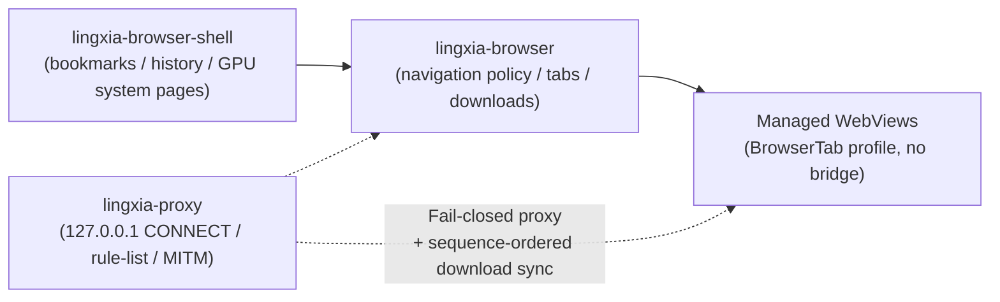

# Browser Runtime, Browser Shell, and Local Proxy

> **Audience**: framework developers and maintainers working on `lingxia-browser`,
> `lingxia-browser-shell`, `lingxia-proxy`, or `lingxia::embedded_browser`. WebView creation and
> teardown live in [`webview-lifecycle.md`](webview-lifecycle.md).

## 1. Mental Model

LingXia's embedded browser splits cleanly into three layers: `lingxia-browser` owns navigation
policy, tab state, and download ownership; `lingxia-browser-shell` owns user-facing persistence
(bookmarks, history, privacy, address bar) and bundled GPU View system pages; and `lingxia-proxy`
provides an optional local CONNECT/MITM proxy coordinated fail-closed with WebViews and downloads.

---

## 2. `lingxia-browser`: Core Runtime

- **Identity & authority**: the built-in browser owns app id `app.lingxia.browser` and receives a
  single-install `NativeControlPlaneAuthority` at bootstrap so it can host its own `ControlSurface`
  system pages.
- **Navigation policy**:
  - `http`, `https`, `lx` (main frame only), `file`, `about:blank`, and `about:srcdoc` stay
    in-WebView; `about`, `data`, `blob`, and `javascript` are never handed to external apps.
  - External schemes require **both** main-frame navigation and user gesture. A short-lived
    transient user-activation window (10 s) carries activation across `http(s)` redirects (such as
    OAuth → custom scheme) and is consumed on first external launch.
  - Target URL normalization upgrades `http://` to `https://` except for loopback (and, in dev
    sessions only, private LAN IPs).
- **Tab state and lock invariants**:
  - Each tab UUID maps 1:1 to a managed WebView under `app.lingxia.browser` with a monotonic
    creation token to discard stale async callbacks and pending-URL coalescing during creation.
  - Existing tabs cannot silently flip ephemeral/persistent `data_mode` or `standalone` status
    (explicit promote/demote is disallowed for ephemeral or `url_callback` tabs; `url_callback`
    tabs also block all `file:` navigations including redirects).
  - **Lock invariant**: never emit tab-changed or tab-closed notifications while holding the
    browser state mutex — listeners synchronously read tabs or re-enter close.
  - **No bridge on tab documents**: browser tabs never install the LingXia bridge. History
    recording skips ephemeral, standalone, `url_callback`, and load-error documents (tracked via
    explicit error-page flags rather than URL matching).
- **Downloads**: owned by `lingxia-transfer` as browser-owned downloads. Any change to the
  browser download network policy pauses all active browser downloads under the same lock that
  guards task network capture so downloads cannot leak over direct connections.

---

## 3. `lingxia-browser-shell`: Product Shell and System Pages

- **State persistence**: bookmarks (JSON + live watch broadcast + Netscape HTML import/export),
  history (SQLite WAL, `http`/`https` only), privacy controls (`control-surface-only`, backed by
  WebView data stores), proxy settings (macOS/Windows), and cached site icons all live under the
  host's app-state directory. Sidebar pin identity and ordering belong to `lingxia-shell`.
- **Address-bar classification**: `file://` passes through; recognizable hosts/IPs infer `https`;
  bare non-host strings or inputs with whitespace classify as search queries; malformed schemes are
  rejected as invalid.
- **System pages**: bookmarks, history, downloads, and settings are bundled as a GPU View lxapp
  (`app.lingxia.browser`) whose Logic calls `lingxia-browser-shell`'s native routes, and opened as `ControlSurface` pages through the facade.

---

## 4. `lingxia-proxy` and Fail-Closed WebView Coordination

### Local CONNECT proxy
- Binds `127.0.0.1:0` for both `CONNECT` tunnels and plain HTTP forwarding; routing policy
  (`Direct`, `Socks5`, `Block`, rule-list, or auto-switch) swaps atomically for new connections.
- Rule-list updates bootstrap directly through the configured upstream SOCKS5 over HTTPS only.
- **MITM capture** (opt-in `capture` feature):
  - Signs per-domain leaf certificates on the fly from a caller-supplied root CA; `lingxia-proxy`
    never auto-installs certificates into OS trust stores.
  - Upstream TLS always validates against OS native roots (fails if none are available).
  - **Zero-overhead gating**: MITM runs **only** when a capture subscriber is attached and a CA is
    configured (and plain HTTP capture only when a subscriber is attached); otherwise connections
    stay opaque bidirectional tunnels.

### WebView and download coordination (`lingxia::embedded_browser`)
- **Fail-closed**: `require_local_proxy(port)` installs `127.0.0.1:port` without direct failover
  (if the local listener dies, traffic fails closed). Unsupported platforms return an error and
  the caller must not open the page.
- **Platform scope**: Apple scopes to browser data stores (lxapp pages remain unproxied); Android
  and HarmonyOS are app-wide.
- **Threading gotchas**: fails immediately if called on the Android main thread (Chromium acks on
  the main looper); Apple blocks the caller until the main thread applies (never call while the
  main thread waits on the caller).
- **Sequence-ordered download sync**: a monotonic apply sequence ensures a slow WebView proxy
  apply cannot overwrite a newer download routing decision. `block_downloads()` pauses active
  downloads without removing the fail-closed WebView proxy; `reapply_local_proxy()` rewrites the
  existing proxy in place after suspension; `use_system_network()` clears both WebView and download
  proxy routing.
- Browser download history exposed to control pages is capped and stripped of URLs, credentials,
  headers, and filesystem paths.
