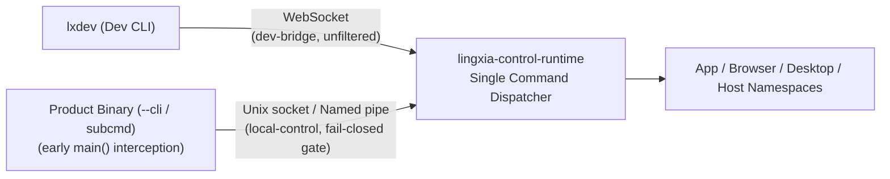

# Host Control IPC and Product CLI

> **Audience**: framework developers and maintainers working on `lingxia-control-protocol`,
> `lingxia-control-runtime`, `lingxia-control-commands`, or `lingxia::product_cli`. This document
> covers **external** CLI/IPC control of a host process; for **in-process** lxapp session classes
> and route authorization, see [`trusted-control-plane.md`](trusted-control-plane.md). Dev
> WebSocket broker lifecycle lives in [`dev-session.md`](dev-session.md); companion relay details
> live in [`companion-protocol.md`](companion-protocol.md).

## 1. Mental Model

LingXia exposes one unified JSON request/response control plane over two strictly separated
transports: an unfiltered **dev bridge** for development sessions, and a fail-closed
**local-control IPC** for shipped desktop products. On desktop, the same product executable also
acts as its own CLI client so the CLI and running host are always version-locked.

---

## 2. Dual-Transport Architecture

### `dev-bridge` (development hosts only)
- Connects over WebSocket when a dev session URL is configured.
- Executes requests serially on a dedicated dispatch worker thread so long-running `eval` calls
  never block log streaming, live network capture, companion replies, or heartbeats. Immediate
  network-watch methods bypass the worker and run inline on the bridge thread.
- Dispatches directly without product capability filtering.

### `local-control` (shipped desktop products)
- Machine-local, newline-delimited JSON IPC stored under `<app_data_dir>/lingxia/control`
  (isolated from host `app_state`), with the active endpoint published atomically via an
  `endpoint` file.
- **OS isolation**:
  - **Unix**: Unix domain socket inside a `0o700` directory (`0o600` socket), removing stale
    sockets before bind and on drop.
  - **Windows**: named pipe with `PIPE_REJECT_REMOTE_CLIENTS`, `FILE_FLAG_FIRST_PIPE_INSTANCE`
    (prevents another local process from pre-creating a weaker DACL), and a current-user-only
    non-inheriting DACL. Named pipes are chosen over `AF_UNIX` for real security descriptors and
    crash-safe cleanup.
- **Epoch invalidation**: disabling local control or stopping the current session increments a
  global epoch; active connection threads check the epoch before every request and drop stale
  clients.
- **Mandatory shell disclosure**: installing `local-control` unconditionally wires the host's
  control-session indicator and stop handler, so automation is disclosed wherever the platform
  draws that indicator. Because CLI
  clients connect per request, bursts are grouped into a session that idles out after 20 s.
- **Zero-dependency client**: the client opens a fresh stdlib connection per request (no OS
  SDK crate needed on the client).

---

## 3. Single-Binary Product CLI

Shipping one binary for both GUI and CLI eliminates CLI/app version drift:

- **Early argv interception**: hosts must call `product_cli::run_if_invoked*` as the **first step
  in `main`**, before UI or runtime init, so CLI invocations never open or contend on the running
  instance's databases.
- **8 MiB CLI stack**: CLI parsing and execution run on a dedicated 8 MiB stack thread because the
  derived `clap` command tree overflows Windows' default 1 MiB main-thread stack in unoptimized
  debug builds.
- **Invocation detection**: `--cli` is stripped before parsing. CLI mode activates on `--cli`, a
  known built-in or host-registered subcommand in `argv[1]`, or (on non-Windows) an interactive
  stdin TTY. **Never** test stdout/stderr TTY — GUI dev launchers detach stdin while keeping
  stdout/stderr attached for logs.
- **Windows console**: GUI-subsystem binaries attach to the parent console, switch output to UTF-8,
  and restore the previous code page on exit.
- **Host-registered commands**: must use lowercase kebab-case names and panic at registration if
  they shadow built-in commands. Product CLI puts own-app commands at root and prefixes machine
  automation with `computer` (inverse of `lxdev`, which targets arbitrary apps).

---

## 4. Compile-Time Isolation, Scope Gate, and Error Framing

### Compile-time dev/product isolation
Dev and test tooling is excluded from shipped products at **compile time**, not merely
runtime-gated:
- `dev-bridge`, `test-runtime` (`session.test.*`, `session.network.*`, `lingxia-automation`,
  `lingxia-network-dev`), `devtool`, and `desktop-local` are omitted from product builds.
- `computer-use` is kept separate from `local-control` so products without desktop automation do
  not link Accessibility or Screen Recording code.
- `lingxia`'s `computer-use` feature atomically enables both the CLI subcommand table and the
  in-process driver so they never drift.

### Fail-closed `local-control` gate
- Missing app config or capabilities refuses every method except `echo` (liveness probe) and
  host-registered namespaces (which panic at registration if they shadow any framework namespace).
- `desktop.*` requires `computerUse`; `browser.*` requires `browserUse`.
- `app.*` requires `appUse` **and** membership in the explicit 5-method allowlist (`doctor`,
  `screenshot`, `windows`, `mouse`, `keyboard`).
- `lxapp.*` is **always refused** on `local-control` (it exposes arbitrary Logic `eval` and
  install/lifecycle).

### Deterministic error and exit codes
Runtime handlers tag errors with canonical codes (`usage`, `not_found`, `ambiguous`, `timeout`,
`permission`, `unsupported`, `unavailable`, `stale`, `failed`), which map deterministically to CLI
exit codes `2..=10` for agent branching. Destructive actions require `--allow-destructive` (or
`LXDEV_DESKTOP_ALLOW_DESTRUCTIVE=1`), else fail locally with permission exit code `6`.
