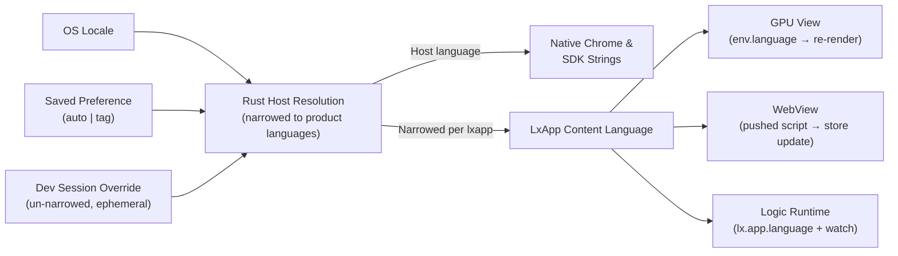

# Languages and Internationalization

> **Audience**: framework developers and maintainers working on language resolution, catalogue
> compilation, runtime formatting, RTL layout, or host SDK strings. Author-facing usage lives in
> [`docs/skill/lxapp/guide.md`](../skill/lxapp/guide.md).

## 1. Mental Model

LingXia treats language as a **single product-wide decision owned by the Rust host**, not a
per-page or per-lxapp setting. Two lxapps inside one product never disagree on language with each
other or with the host's native chrome.

Four architectural principles follow from this model:

- **One resolution chain, in Rust**: no View, Logic context, or platform SDK chooses a language on
  its own. Views only read `env.language`; Logic only reads `lx.app.language` (never sets it).
- **Zero-reload switching**: changing the language never reloads a page and never restarts Logic.
  GPU pages re-render from their environment, WebView pages update via a pushed notification, and
  manifest-bound native chrome re-resolves from its keys.
- **Final text on the View wire**: message keys never cross the GPU View wire. Renderers, screen
  readers, and native text inputs receive resolved strings. Translated strings also never belong in
  page `data` (nothing re-translates them on a switch) — Logic stores keys and arguments and lets
  the View translate.
- **Three separated text stores**: lxapp catalogues, framework/package words, and host SDK strings
  have different update lifetimes and stay separate.

---

## 2. Language Ownership, Narrowing, and Live Propagation

### Resolution chain

1. **System locale**: read from the OS at startup and on OS locale-change notifications (single
   primary system locale, not the OS fallback list), then narrowed to the product's declared
   `languages` (default `en-US`, `zh-CN`; first entry is fallback).
2. **Host preference**: `'auto'` or a specific tag persisted in host app data, writable only by the
   host or an authorized Control app. A pinned tag is narrowed to the product's languages just like
   the system locale. This yields the **host language**.
3. **LxApp narrowing**: each lxapp narrows the host language to the `languages` declared in its
   manifest, yielding the **page language** (an lxapp declaring no languages inherits the host
   language directly).
4. **Dev session override (highest precedence)**: `lxdev runner set --language <tag|auto>` installs
   an ephemeral override without narrowing to the product's languages so tests can force any tag;
   each lxapp still narrows it.

### Narrowing algorithm

One shared Rust narrowing rule applies everywhere (host, lxapp, and manifest text):

1. Exact tag match (ignoring case and `_`/`-`).
2. Best candidate sharing the primary language, scored by script match (`+4` match, `-4` mismatch;
   Chinese regions imply script: `TW`/`HK`/`MO` → `Hant`, `CN`/`SG`/`MY` → `Hans`) and region match
   (`+2`). A different-script candidate still beats the fallback list.
3. First entry in the declared list.

### Live propagation and race safety

- **Persist before publish**: a preference change is written to disk first; a failed write
  publishes nothing so the UI never displays a language the next launch forgets.
- **Monotonic revisions**: every transition carries a revision number and publishes in strict
  order (concurrent transitions queue behind the active one).
- **Ready-handshake race**: a page loading during a switch may miss the broadcast, so the runtime
  pushes the current language again when the page's bridge reports ready. Both carry revisions and
  the receiver keeps only the higher one. Similarly, Logic's `watch` registers its listener before
  snapshotting the current value and drops events at or below the snapshot revision.
- **What does not auto-update**: strings Logic already passed imperatively to native chrome
  (`tabBar.update`, `navigationBar.update`, `moreActions`, tray/sidebar actions, open dialogs) or
  captured from `lx.app.t` must be re-applied by Logic via its language watcher. System settings
  such as `hourCycle`, `firstWeekday`, and text scale are independent of app language.

---

## 3. Three Text Stores and Lookup Precedence

| Store | Lifetime & Owner | Shipping Form | Follows |
| --- | --- | --- | --- |
| **LxApp catalogues** | Owned by the lxapp; updates independently of the host | Compiled JS in page bundles + raw JSON for Logic and manifest text | Page language |
| **Package words** (`@view.*`, `@liuli.*`) | Owned by framework/UI packages; works in every lxapp without app translation | Pre-generated JS embedded in the View runtime and UI packages | Page language |
| **SDK strings** | Owned by LingXia + host project overrides; needed before any page runs or read by the OS | Native OS resources (Android/Apple/Harmony) + compiled Rust table (Logic/Windows) | Host language |

### Override and fallback rules

- **LxApp keys**: look up in the page language's catalogue, then the lxapp's source catalogue;
  missing in both is an error (`UI_I18N` in Views, `E_NOT_FOUND` in Logic).
- **Package words (`@<namespace>.*`)**: an lxapp may override a package word, but the runtime reads
  overrides **only** from the active page language's catalogue — never from the lxapp's source
  catalogue — so a source-language override cannot clobber the package's own translation in another
  language. Otherwise falls back to the package's words in the page's primary language, then the
  package's source language.
- **SDK strings**: host-drawn UI (permission prompts, dialogs, shell chrome, page-failed panel)
  reads host-project overrides first, then LingXia's bundled native resources (via platform
  resource lookup on Apple/Android/Harmony, or primary-language table on Logic/Windows), then
  English. Host projects only *override* or *extend* SDK strings rather than translating them from
  scratch, keeping LingXia's internal keys decoupled from app release cycles.

---

## 4. Catalogue Compilation and ICU Subset

LxApp and package catalogues use flat FormatJS JSON (`{ defaultMessage, description }`), where
`description` is mandatory in the source catalogue for translators.

### Supported ICU MessageFormat 1 subset

To guarantee identical semantics across Rust and JS targets, the parser accepts a strict subset:
plain `{name}`, `{n, number}` (`integer`, `percent`), `{d, date}` / `{d, time}` (`short`, `medium`,
`long`), `{n, plural}` / `{n, selectordinal}` (with `offset`, `=N`, CLDR categories, `#`),
`{s, select}`, paired `<tag>…</tag>`, and standard apostrophe quoting. `choice`, format skeletons,
and unclosed/self-closing tags are rejected.

### Signature checks and build vs dev modes

Every message compiles to a typed signature (each argument's kind and allowed `select` cases, plus
tags). Build-time checks (`lingxia build`, `lingxia check`, `lingxia dev`) validate key syntax,
missing source keys referenced by literal `t('...')` / `lx.app.t('...')` calls or manifest entries,
`@<namespace>.*` overrides against installed packages, and translation signature drift.

- **Release builds** fail on any error.
- **Dev builds** warn and fall back to the source message on non-source signature drift or
  untranslated keys, and exempt `@` override keys from missing-translation checks.

### Compilation pipeline

Catalogue compilation runs **before** page bundling so the page compiler can import the generated
modules and prepend catalogue registration before page code executes (ensuring `t` works on the
first render). Compilation emits:

- A shared TypeScript `LxAppMessages` interface (typing literal keys and their argument shapes;
  dynamic keys must cast to a branded key type and bypass static checks).
- Per-language compiled JS functions that delegate formatting to a tiny runtime helper (`f`) rather
  than shipping a runtime ICU parser.
- Raw JSON catalogues alongside the bundle for Logic's Rust formatter and native manifest text.

Because every page bundle imports the compiled catalogue index, all declared languages of an lxapp
ship with each page (bundlers cannot tree-shake per language); plural tables are pruned to only the
languages declared by that lxapp.

---

## 5. Plurals, Formatting, and `Intl` Across Engines

- **Shared CLDR plural rules**: one offline generator converts CLDR cardinal/ordinal rules into
  both Rust functions and compact JS expressions, verified against a shared CLDR sample matrix so
  Logic (Rust) and Views (JS) always pick the same category.
- **BiDi isolation**: when a message's language is RTL or an interpolated argument contains RTL
  characters, both formatters wrap text arguments in `FSI…PDI` and numbers/dates/times in
  `LRI…PDI` so mixed-direction interpolation never scrambles sentence order.
- **Built-in message helpers vs `Intl`**:
  - Inside ICU messages, the lightweight `f` formatter handles numbers, simple dates/times, plurals,
    selects, and tags identically across all page types (even on QuickJS where `Intl` is absent).
  - Outside messages, LingXia does **not** ship its own CLDR formatter or shadow native `Intl`:
    formatting helpers wrap the engine's native `Intl` while explicitly passing the app's language,
    time zone, and hour cycle (because bare `Intl` on JavaScriptCore and ArkJS follows the OS
    locale rather than the app's display language).
- **Engine availability**: JavaScriptCore (Apple Logic), ArkJS (Harmony Logic), and system WebViews
  provide native `Intl`; QuickJS (all GPU View isolates, Android/Windows Logic) does not, so
  zone-aware helpers fail with `E_NOT_SUPPORTED` where `Intl` is unavailable.

---

## 6. Right-to-Left (RTL) and Pseudo-Locales

- **Direction derivation**: the Rust View core derives `env.direction` from `env.language` (script
  subtag first, then primary language). The GPU renderer mirrors layout, flow-relative
  spacing/borders/radii, text alignment, horizontal scroll origin, popover anchors, and composite
  widget arrow keys directly from `env.direction` without re-running the View. Text shaping locale
  also follows `env.language` so Han glyph variants and font fallback match. WebView documents set
  `lang` and `dir` on `<html>`.
- **Boundaries**: Logic receives no direction; host-drawn native chrome relies on OS
  toolkit RTL behavior rather than explicit per-widget overrides.
- **Dev-only pseudo-locales (`en-XA`, `ar-XB`)**: generated automatically from the source catalogue
  in dev builds only (never shipped) and injected into both the lxapp and dev host language lists
  so they survive narrowing:
  - `en-XA` accents characters, pads length ~40%, and brackets messages to expose clipping and
    hard-coded strings.
  - `ar-XB` mirrors runs with RTL overrides under an Arabic tag so full RTL layout can be verified
    before translations exist.

---

## 7. Key Invariants to Preserve

- **OS language picker alignment**: the build declares the product's `languages` to each OS
  (`CFBundleLocalizations`, Android `localeConfig`, Harmony `AppScope`) so the system's per-app
  language picker matches what the host actually supports.
- **No machine-translated store metadata**: permission prompts and `Info.plist` strings reach store
  review and users before any page runs; never ship them unreviewed.
- **Atomic dev writes**: compiled catalogue outputs and active-version pointers are written to
  temporary paths and renamed into place so concurrent dev sessions never read partial files.
- **Schema lockstep**: `language` and `direction` environment keys come from the View contract
  schema; CLI, runtime, and host must move together if environment keys change.
- **Line-separator escaping**: compiled JS message strings must escape `U+2028`/`U+2029` for older
  JS parsers.
- **Regenerate and commit**: any change to SDK string YAML, package words, plural rules, or the JS
  formatter requires running `lingxia gen i18n` and committing generated artifacts (verified in CI
  via `--check`).
