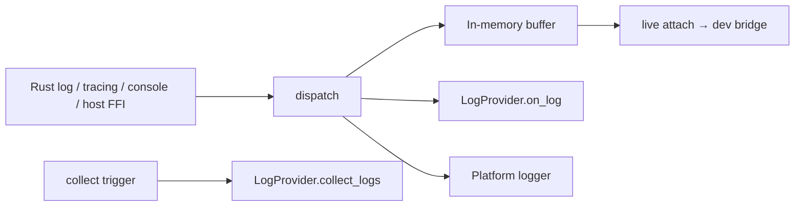

# Logging

> **Audience**: contributors working on the LingXia runtime, the dev bridge, or
> log providers. App authors have no surface here: lxapp code uses `console.*`,
> host Rust uses `log`/`tracing` macros, and the runtime captures both.

Every log line in a LingXia host, whatever its source, becomes one
`LogMessage` and goes through one synchronous dispatch that feeds an in-memory
buffer, an optional provider, and the platform logger. The model is
transport-agnostic; this doc defines no backend.

Invariants:

1. Dispatch is synchronous and lightweight.
2. A provider's realtime hook neither blocks nor emits LingXia logs.
3. Recent history is bounded in memory.
4. Collection storage, selection, encoding and transport belong to the provider.
5. Platform logger output does not depend on whether a provider is registered.
6. One level threshold gates Rust `log` records and host (SDK) logs alike.

Ownership: `lingxia-log` (model, dispatch, buffer, provider),
`lingxia` (init, level policy, `log` bridge, host FFI, platform sinks),
and `lingxia-lxapp` (runtime log macros).

## Pipeline

Dispatch pushes the message into the buffer, calls the provider's `on_log` on
the caller's thread, then writes the platform logger.

| Source | Enters through | Tag |
| --- | --- | --- |
| Rust `log` records | the SDK `log` logger (installed at init) | `Native` |
| `tracing` events | the log tracing layer, installed at log init | the event's `log_tag` field, else `Native` |
| lxapp page console | runtime | `WebViewConsole` |
| Logic console | `tracing` events on target `rong.js.console` | `LxAppServiceConsole` |
| Built-in browser tab console | runtime | `BrowserConsole` |
| Host automation runs | automation runtime (`path` = run id) | `Automation` |
| Swift / Kotlin / ArkTS SDK code | `forwardHostLog` FFI | `Native` |
| Runtime code | `lingxia-log`'s builder API, `lxapp`'s `info!`/`warn!`/`error!`/`debug!`/`verbose!` | caller's |

The tracing layer is part of log init because Logic console output
arrives as `tracing` events, not through the `log` facade.

## Data model

`LogMessage`: `timestamp_ms`, `tag`, `level`, `appid`, `path`, `target`,
`message`. `LogLevel`: `Verbose`, `Debug`, `Info`, `Warn`, `Error`.
The display tag in platform output is `Native`, `LXView`, `LXLogic`,
`Browser` or `Automation`.

## Level policy

One host log level is the single threshold. `LINGXIA_LOG_LEVEL` pins it;
otherwise a dev session starts at `debug` and everything else at `info`.
Setting the level at run time also pins it. On devices the dev WebSocket URL
is only known once app config loads, so the dev-session default is re-checked
then. The Android logcat and Harmony
hilog sinks fix their own cap when first built, so a later raise reaches the
buffer and `lxdev logs` but not logcat/hilog.

The SDK `log` logger passes dependency crates' records only at `warn` and above; only
LingXia's own targets (`lingxia*`, `lxapp*`, `rong*`, `macos*`) pass detail.
Renderer, HTTP, TLS and WebSocket crates log every step at info/debug, which
would otherwise flood the dev log stream during a bundle sync.

## Host FFI

SDK code logs through `forwardHostLog(level, category, appId, path, message)`
and guards hot paths with `hostLogEnabled(level)` (Apple `LXLog`,
Android `LxLog`, Harmony `LxLog`). Levels are `0` verbose … `4` error; `category`
becomes `target`. Before the pipeline exists (early cold start) the record goes
straight to the platform logger so bootstrap warnings are not lost.

Forward errors and important warnings only. These records are buffered for
upload and crash diagnosis, and routine traffic would evict the errors the
buffer exists to keep; lifecycle and debug detail stays on os_log / logcat /
hilog.

## Buffer and live attach

The buffer holds a bounded broadcast channel for live subscribers (1024) and
a bounded history deque (2048) that evicts from the front.

Attaching a live stream (default replay 500) returns a replay window and a
live receiver taken together under the history lock, so
a viewer gets recent context and then tails with no gap or duplicate at the
boundary. The dev bridge (`lingxia-control-runtime`) uses it to
serve `lxdev logs`.

## Provider

`LogProvider` has two hooks, both no-ops by default:

- `on_log(&LogMessage)`: realtime, synchronous, on the caller's thread. It must
  enqueue quickly. It must not emit LingXia logs: same-thread re-entry is
  dropped by a dispatch guard, cross-thread re-entry is not detected.
- `collect_logs()`: triggered by the `lingxia-log` collect call. The provider
  selects records from its own store and owns batching, encoding, transport,
  acknowledgement and retry. The trigger carries no payload and no limit, so
  the runtime never builds data a provider would have to decode or discard.

`lingxia_log::register_log_provider` registers one provider before SDK
initialization; a second call panics. Without one, buffering and platform
output still work. Infrastructure crates such as a cloud provider depend on
`lingxia-log` directly, not on the `lingxia` facade.

## Downstream logger

`lingxia::log::register_downstream_logger` installs a second Rust `log` logger
that receives every record the SDK `log` logger accepts. It exists for hosts that mirror
Rust `log` output into their own sink. It sees only Rust `log` records, not
console or host FFI logs; structured integration is `LogProvider`.

## Platform output

The facade mirrors every dispatched message to `android_logger`
(Android), `ohos_hilog` (Harmony), `oslog` (Apple), and stderr elsewhere
(Windows).
