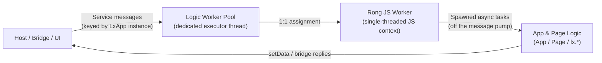

# Logic Runtime and Worker Pool

> **Audience**: framework developers and maintainers working on the Logic JS runtime, worker
> scheduling, teardown, extension registration, or cross-cutting Logic contracts. Authorization
> rules live in [`trusted-control-plane.md`](trusted-control-plane.md); page lifecycle lives in
> [`webview-lifecycle.md`](webview-lifecycle.md).

## 1. Mental Model

Every Logic-enabled lxapp runs its business logic inside an isolated JS context hosted on a
dedicated Rust worker pool, completely decoupled from UI rendering threads. Views never execute
Logic code directly; all state mutations, platform API calls, and lifecycle events cross a
message-passing boundary into the owning worker.

---

## 2. Engine Pinning and No-JS Builds

Each platform pins a single JS engine and TLS backend at compile time so behavior and binary
footprint stay predictable:

| Platform | JS Engine | Why |
| --- | --- | --- |
| Apple (`ios`, `macos`) | System JavaScriptCore | Zero engine binary size, native `Intl`, platform-tuned JIT/memory |
| HarmonyOS | ArkJS | Platform-native JS runtime |
| Android / Windows / desktop fallback | QuickJS | Portable, small footprint, deterministic embedder control |

- **No-JS builds**: hosts compiled without JS app-service support still run bridge handshakes and
  state plumbing for `logic: false` pages; only Logic-enabled operations fail as unsupported.
- **Built-in Rong modules**: every requested built-in module must match a compiled Cargo feature
  (fail-fast at startup). Shell/command execution is never compiled or exposed, and
  `globalThis.Rong` is sealed and frozen **before** any extensions or app code run.

---

## 3. Worker Pool and Message Pump Discipline

Because JS contexts are single-threaded, the Logic worker pool runs on a dedicated executor OS
thread hosting a shared set of Rong workers.

- **Instance-keyed routing**: worker assignments key on live lxapp instance identity rather than
  `appid`. When an app restarts, the new instance gets a fresh assignment so late messages from the
  old session cannot land on the new one.
- **Creation ordering**: app-service creation is enqueued under the assignment lock before
  publishing the active mapping, preventing concurrent page creation from overtaking app bootstrap.
- **Never block the pump on user JS**: lifecycle hooks, bus events, native page handlers, and
  automation evals always spawn onto the context asynchronously rather than awaiting on the worker
  pump. Blocking the pump on user JS would starve View bridge handshakes, `setData` acks, and
  `page.flush()`.
- **Immediate microtask drain**: after handling each service message, the worker drains pending JS
  jobs immediately. Without this, non-JSCore engines wait for a periodic fallback tick and throttle
  `await page.flush()`.
- **Timer capture order**: real `setTimeout`/`clearTimeout` handles for `setData` batching are
  captured after the timer module initializes and **before** extensions or app code run, keeping
  `setData` delivery immune to fake test clocks.
- **Context drop order**: spawned JS futures must drop before their owning JS context handle,
  because JS values do not retain the context.

---

## 4. Teardown and Worker Quarantine

Teardown must leave neither dangling JS roots nor wedged workers:

1. **Synchronous cut-off**: session cancellation immediately rejects new native API calls before
   the worker even dequeues its termination message.
2. **Ordered context shutdown**: termination cancels pending bridge work, marks the assignment as
   terminating under one lock, drains timers and context-owned tasks, releases native references to
   JS page/app objects, and performs one final microtask drain **while the context opaque state is
   still alive** (a callback firing after drop aborts across FFI).
3. **Network cut-off**: the HTTP access guard is replaced with a deny-all guard before releasing
   the worker so no in-flight JS network work outlives teardown.
4. **Quarantine on timeout**: if a worker fails to acknowledge termination within the timeout, it
   is **quarantined** (withheld from the free pool) until a late ACK arrives, preventing a wedged
   context from corrupting the next app.
5. **Reactivation race**: if a restart arrives while termination is still in flight, the new
   creation queues behind the pending termination and supersedes the old termination token so the
   old ACK cannot free an active worker.

---

## 5. Extension Registration Boundary

Logic extensions are split into two audiences:

- **Standard-only**: initialized only in standard guest lxapps; never enters `ControlApp` or
  `ControlSurface`.
- **Host-assigned**: initialized in all contexts.

Public extension registration outside synchronous host bootstrap always registers standard-only.
Framework runtime and host-addon registration cross private internal link boundaries so downstream
crates cannot forge control-capable extensions. Host-bundled narrow control surfaces (such as
Terminal Settings) short-circuit standard runtime registration and expose only their own narrow
API surface.

---

## 6. Cross-Cutting Logic Contracts

- **Open gate**: page handles buffer `close`/`show`/`hide` calls issued before the page appears on
  screen; cancelling before settlement aborts `opened` and resolves `result` as user-canceled.
- **Dismissal vs failure**: user-dismissable APIs resolve to `{ status: 'canceled' }` rather than
  rejecting; rejections always mean real errors. Native platforms signal user dismissal with
  business code `2000`.
- **Authorization before decode**: unauthorized Logic routes reject with `E_PERMISSION_DENIED`
  (business code `3000`) *before* decoding JS arguments. Guest notifications and banners are
  namespaced by app id so guests cannot collide with or spoof product notifications.
- **Message ports**: unconstructable from JS; buffer incoming messages until the first subscriber
  attaches, then drain asynchronously *after* `onMessage` returns so the handler already holds its
  unsubscribe handle.
- **Task objects**: single-consumer async iterators (second iteration throws `E_INVALID_STATE`);
  normal completion yields `task.result`, and early `return()` cancels the underlying transfer.
- **State batching**: GPU pages coalesce writes within one JS task (`0 ms` delay); WebView pages
  coalesce within a `16 ms` window using the captured real timers.
