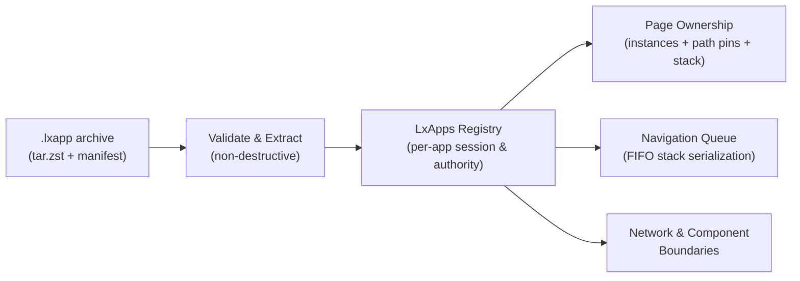

# LxApp Container Core and Native Components

> **Audience**: framework developers and maintainers working on `lingxia-lxapp` core container
> mechanics (outside [`bridge-protocol.md`](bridge-protocol.md),
> [`webview-lifecycle.md`](webview-lifecycle.md), [`storage.md`](storage.md),
> [`update-pipeline.md`](update-pipeline.md), [`i18n.md`](i18n.md), and
> [`shell-ui-spec.md`](shell-ui-spec.md)) or `@lingxia/elements`.

## 1. Mental Model

An lxapp is a signed, self-contained package (`tar.zst` archive + `lxapp.json` manifest) loaded
into an lxapp container managed by the process-wide lxapp registry. The container owns three
things: safe extraction and startup, page instance ownership and navigation serialization, and
outbound network/component boundaries.

---

## 2. Archive Extraction and Manifest Validation

### Archive hygiene
- `.lxapp` packages are `tar.zst` archives.
- **Full-file read before decode**: extraction reads the archive into memory before decoding rather
  than streaming from an OS `File` handle, avoiding HarmonyOS cache-handle failures during
  streaming `zstd+tar` walks.
- **32-bit window cap**: the zstd window log is capped at `30` on 32-bit targets (`31` on
  64-bit) so decoder setup does not fail on 32-bit devices.
- **Non-destructive pre-validation**: magic bytes and decoder initialization are validated *before*
  clearing the destination directory so a corrupt download preserves the existing install.
  Permission and xattr preservation are disabled during unpack.

### Manifest rules (`lxapp.json`)
- `"appService"` and `tabBar` styling/path keys are rejected.
- A top-level `"security"` key is **ignored**; network and privilege permissions live in the
  registry record, not the manifest.
- `renderer` (`webview` or `gpu`) is manifest-wide; page entries forbid unknown fields.
- `minRuntime` is checked against the host runtime (failing with runtime-upgrade-required).
- Page paths and logic entry paths must be relative with normal segments only, no backslashes, and
  no `WebTag` child markers (`~child~`); plugin names and versions must be single safe path
  components.

---

## 3. Startup, Bootstrap, and Registry Invariants

- **Private bootstrap edge**: runtime bootstrap is exported only through a private internal link
  boundary so downstream extensions cannot call bootstrap directly or mint host authority tokens.
- **Home app refresh order**: dev-path sources serve directly; otherwise a dev session, changed
  dev bundled-asset digest, or newer bundled version triggers reinstall before any pending
  downloaded update is applied.
- **Typed launch parameters**: string params stay as plain query pairs; non-string JSON values pack
  into reserved `__lxparams` (bounded to 8 KiB; user code cannot use that key). Launch URLs are
  exposed only for `AppLink` launches and cleared after Logic reads them.
- **Registry concurrency invariants**:
  - Per-app transition locks serialize session replacement so the native-assigned session class
    cannot be lost between remove and reinsert.
  - Never look up an `appid` in the active-apps map while holding an iteration guard on it
    (collect references first to avoid deadlock).
  - Removed instances stay tracked until Logic acknowledges termination.
  - `Main` vs `Aside` open region is claimed atomically under the presentation lock and released
    only on close, not hide.

---

## 4. Page Ownership, Navigation Queue, and Stack Rules

- **Single page owner**: one instance map owns every live `PageInstance`; path pins map route
  path → instance id only for path-pinned singletons (tab pages and headless services); the page
  stack stores **instance ids**, never paths.
- **Path lookup precedence**: topmost matching stack entry → path-pinned singleton → most recently
  active non-isolated off-stack instance. **Surface-isolated instances never resolve by bare path**;
  address them only by instance id or `WebTag`.
- **Stack uniqueness & LRU protection**: navigation never shares one `PageInstance` across two
  stack entries (the same non-tab route can stack multiple times). Pages on the stack, path-pinned,
  or in isolated surfaces are never evicted by LRU.
- **Navigation queue**: serializes `lx.nav` stack operations FIFO per lxapp (max 8 waiting). Only a
  request identical to the last *waiting* one coalesces with it; running operations are
  never joined. Dropping a ticket before its turn marks it abandoned so the queue never deadlocks.
- **Stack preflight**: forward navigation onto an already-open pinned tab or a full stack
  (10 pages) fails before mutating query/opener state; `redirectTo` cannot target a
  tab page; public View navigation routes require configured page names and reject raw paths.

---

## 5. Native Authority and Network Access Guards

- `NativeControlPlaneAuthority` has no public constructor, `Clone`, serde, or global getter; it
  validates against the active platform instance by identity (see
  [`trusted-control-plane.md`](trusted-control-plane.md)).
- **Network security**:
  - Empty `trusted_domains` means **deny all**. Wildcards (`*.example.com`) match subdomains only;
    single-label wildcards (such as `*.localhost`) are rejected. `*` allows every public host.
  - Every request and redirect is checked against session cancellation, domain allowlist, and a
    DNS-rebinding guard that rejects if *any* resolved IP is non-public (loopback, RFC1918,
    link-local, ULA, multicast, or IPv4-mapped private IPv6).
  - **Dev-session relaxation**: private IPs are allowed in dev sessions **only** when the request
    host is a literal IP address (and still permitted by `trusted_domains`). A domain resolving to
    a LAN IP is still rejected even in dev mode.

---

## 6. Native Components (`@lingxia/elements`)

WebView native-component traffic (`mount`, `update`, `unmount`, `ready`, `page.scroll`) uses two
transport architectures depending on platform capabilities:

- **Apple / Android / HarmonyOS (direct platform channels)**: `@lingxia/bridge` posts straight to
  platform-native channels, bypassing `lingxia-lxapp`. Platform component managers own lifecycle
  and visibility directly.
- **Windows (in-process Rust component host)**: WebView2 has no separate
  native-component channel, so an injected shim wraps component messages over standard
  `window.chrome.webview.postMessage`, enables throttled scroll/resize tracking, and disables
  compositor overscroll (`overscroll-behavior: none`) so Win32 overlays do not tear away from DOM
  rects. `lingxia-lxapp` intercepts the envelope and dispatches to the in-process
  component host registered by `lingxia-windows-sdk`, also forwarding page visibility and
  destruction.
- **Handshake & platform quirks**: host events buffer per component until the View registers its
  handler and sends `component.ready`. On Windows, Win32 mutations marshal to the window thread
  without holding state locks across re-entrant Win32 calls. On iOS, `@lingxia/elements` injects an
  oversized scrollable child container so WebKit creates a `WKChildScrollView` host.
