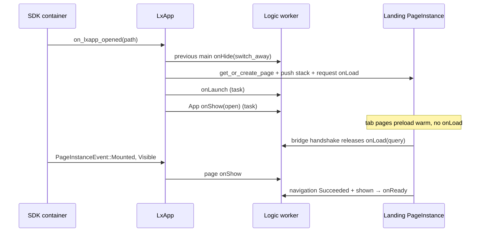

# Page Lifecycle (Cross-Platform)

What `App` and `Page` hooks fire, in what order, and which runtime event owes
each one. The WebView objects behind a page, how they are created, discarded
and destroyed, are in [`webview-lifecycle.md`](webview-lifecycle.md); this file
links there for mechanics and does not repeat them.

## Mental model

Three layers advance independently. Mixing them up is the usual bug.

| Layer | Unit | Hooks | Driven by |
| --- | --- | --- | --- |
| App | `LxApp` session | `onLaunch`, `onShow`, `onHide` | `LxAppDelegate` (open, switch, close) and the host's foreground/background |
| Page | `PageInstance` | `onLoad`, `onShow`, `onReady`, `onHide`, `onUnload` | Navigation, the SDK container's visibility events, render completion |
| WebView | native view | none | Creation, discard, teardown ([WebView lifecycle](webview-lifecycle.md)) |

- **Visibility comes from the SDK container, never from `lingxia-webview`.**
  Page `onShow`/`onHide` follow `PageInstanceEvent::Visible`/`Hidden` (or
  `notify_page_host_visibility` on Windows), sent when the container attaches
  or detaches the view.
- **A WebView can go away without any hook,** and a hook can fire on a page
  whose WebView is gone. Discard and LRU eviction fire nothing; reset on pop
  fires `onUnload` but keeps the WebView.
- **App hooks do not gate page hooks.** Each app hook runs as its own task on
  the Logic worker, so an `async onLaunch` that awaits network does not delay
  `App.onShow` or the landing page's `onLoad`. Code that needs `onLaunch` to
  have finished waits on `launch_settled`, as automation's reopen settle does.
- **Page hooks are serial per page.** `PageSvc::enqueue_lifecycle_event`
  awaits each handler's promise before the next, so an async `onLoad` settles
  before that page's `onShow` runs. Different pages do not wait on each other.
  `this.signal` is aborted before `onUnload` runs.

## App hooks

`appservice_notify(AppServiceEvent, args)` is the single entry. Every
`onShow`/`onHide` carries `{ source, reason }`:

| Trigger | Hook | `source` / `reason` |
| --- | --- | --- |
| First open of a session (`on_lxapp_opened`) | `onLaunch`, then `onShow` | `lxapp` / `open` |
| Reopen of a live session, or `reenter_from_link` | `onShow` with launch options | `lxapp` / `switch_back` |
| Another main opens over this one | `onHide` | `lxapp` / `switch_away` |
| Close (native close callback or programmatic close) | `onHide` | `lxapp` / `close` |
| Host process foreground / background | `onShow` / `onHide` | `host` / `foreground`, `background` |
| Screenshot (Apple, Harmony) | `onUserCaptureScreen` | `host` / `screenshot` |

- **An aside never hides the main.** Opening in `Panel` mode skips the
  `switch_away` hide and leaves the main on the lxapp stack top.
- **`onLaunch` fires once per Logic context.** `ensure_app_launch_dispatched`
  guards it with `app_launch_dispatched`.
- **A cold restart replays the open.** `cold_restart_app_service()` keeps the
  host surface, so no native open callback arrives for the fresh Logic. It
  clears the guard and enqueues `App.onLaunch`, then, if the app is currently
  shown, `App.onShow` with `source: lxapp` and `reason: open`. A hidden app
  waits for its next real show. Retained pages replay their own
  `onLoad`/`onShow`/`onReady` through the page gates.
- **AppLink is delivered once.** A cold AppLink rides `onLaunch` options with
  `scene === 8003`; the scene is consumed before the following `onShow`, which
  then carries no options. A warm AppLink rides `onShow` with `switch_back`.
- **Close and late visibility.** The close `onHide` is queued before Logic
  shuts down. `notify_lxapp_host_visibility` and `notify_page_host_visibility`
  drop events while the status is `Closing` or `Closed`, so a destroyed
  WebView's final hide cannot reach a terminating service.
- **`restart()` is close plus a new session.** The old session receives the
  close `onHide`; the new one runs `onLaunch`, `onShow(open)` and the initial
  route's `onLoad`. A restart requested while `Opening` (for example
  `applyUpdate` inside `onLaunch`) is deferred until `on_lxapp_opened`
  finishes. A restart is not a user activation: it must not raise the host
  window above other apps.

## Cold open, end to end



## PageInstance

A `PageInstance` wraps a `Page` (which holds the `WebView`) and is the unit that
`LxApp` tracks in its page maps. Its identity lives on the instance; its
ownership / presentation / disposal policy live in a side record
(`PageInstanceRuntimeRecord`, keyed by instance id in
`LxAppState.page_instance_runtime`).

### Identity

Every `PageInstance` has a unique `PageInstanceId` (UUID v4). A single page path
(e.g. `/home`) can have multiple `PageInstance` objects alive simultaneously —
for example, the main-window instance and a surface overlay instance of the same
path.

`LxApp` maintains two maps (both keyed by `String`):
- `pages`: `path → PageInstance` (the canonical instance for each path).
- `pages_by_id`: `instance_id → PageInstance` (all instances, including isolated
  ones).

An **isolated page instance** (created by `create_isolated_page_instance()`) is
registered only in `pages_by_id`, not in `pages`. This is used for surface page
targets so they don't replace the main-window page at the same path.

### Owner

Each `PageInstance` has a `PageOwner` that determines lifecycle coupling:

| Owner | Meaning | Surface close cascades? |
| --- | --- | --- |
| `Page(PageInstanceId)` | Created by another page (e.g. a surface opened from a page) | Yes — when the owner page is disposed, its owned surfaces are closed |
| `Scene(SceneId)` | Created by a scene / system-level context | No per-page cascade |
| `Host` | Fallback for pages without an explicit runtime record | No |

The owner is recorded in `PageInstanceRuntimeRecord` and used by
`close_surfaces_for_owner()` when a page instance is disposed.

> **Cascade reason is conditional.** The owned surfaces are closed with
> `CloseReason::OwnerClosed` normally, but with `CloseReason::AppClosed` when the
> disposal is part of app shutdown.

### Presentation Kind

`PresentationKind` records how the page is presented:

| Kind | Meaning |
| --- | --- |
| `Window` | Standard full page (main LxApp window, or a surface window) |
| `Overlay` | Surface overlay |
| `Panel` | Defined but currently **unused** — see note |

> **`Panel` is not reachable from surfaces today.** `SurfaceKind` only has
> `Window` and `Overlay`, and `open_surface()` maps `Window→Window`,
> `Overlay→Overlay`. No code path produces `Panel`; treat it as reserved.

### Dispose TTL and `CloseReason::Reclaimed`

A `PageInstance` can have an optional `dispose_ttl` (duration). When the page
receives a `Hidden` event whose reason is **not** `AppClosed`:

- If `dispose_ttl` is set: a timer is scheduled. When it fires, the instance is
  disposed (WebView destroyed, PageSvc terminated) **with reason
  `CloseReason::Reclaimed`** — distinct from the original `Hidden` reason, so JS
  can tell SDK-initiated resource reclamation apart from a user/programmatic
  close.
- If `dispose_ttl` is `None`: the page stays alive while hidden (no automatic
  disposal).

Surfaces use a **30-second** dispose TTL (`SURFACE_DISPOSE_TTL_MS = 30_000`).
Regular pages typically have no TTL (they survive hide/show cycles). A
`Hidden { reason: AppClosed }` always disposes immediately, ignoring any TTL.

### Lifecycle State Machine

```
Created → Mounted → Visible ⇄ Hidden → Disposed
```

Transitions are driven by `PageInstanceEvent`. `Visible`/`Hidden` before
`Mounted`, and any event after `Disposed`, are rejected.

| Event | Effect |
| --- | --- |
| `Mounted` | SDK container attached the view; cancels any pending dispose timer |
| `Visible` | Cancels the dispose timer, marks the instance active, dispatches `onShow` |
| `Hidden { reason }` | Dispatches `onHide`; then: `AppClosed` → dispose immediately; else if a dispose TTL is set → start the timer; else cancel the timer (page stays alive) |
| `Disposed { reason }` | Cancels the timer, then runs full disposal (see [PageInstance disposal](webview-lifecycle.md#pageinstance-disposal)) |
| `Resized { width, height }` | Informational; no state change |

## Page hook ordering

`PageInstance` implements `WebViewDelegate`:
- `on_navigation_event(Started)` → sets render status `Started`.
- `on_navigation_event(Succeeded)` for the **current attempt** (folded
  through `NavigationProgress`) → calls `handle_loaded()`, which sets render status
  `Finished`, injects page scripts, then dispatches `OnReady` **via**
  `dispatch_lifecycle_event` (so `OnReady` is gated, not unconditional).
- `on_load_error()` → reports a `LoadError` (default no-op).

`dispatch_lifecycle_event()` enforces ordering:
- `OnLoad` is ignored before render starts.
- First-load / re-navigation order: `OnLoad` (query-aware) → `OnShow`
  (visibility) → `OnReady` (after render finished *and* the page has been
  shown, once per rendered document — a re-navigation onto a cached instance
  repeats `OnLoad`/`OnShow` but not `OnReady`, because nothing re-rendered).
- Handshake does **not** auto-boot `onLoad` for a Hidden Idle page. Preloaded
  tab instances warm a WebView/PageSvc without becoming an entry; the landing
  page on open, first `switchTab` onto a tab, `navigateTo`/`redirectTo`, and
  pages already supposed to be shown (surfaces, app-service restart) request
  `onLoad`. Subsequent `switchTab` onto a warm tab is visibility-only (`onShow`).
- `OnHide` on visibility loss; `OnUnload` on disposal or on leaving the stack.

`PageState` keeps these on three separate clocks, because they advance
independently: `EntryPhase` (`Idle`/`LoadOwed`/`Loaded`) owes one `onLoad` per
logical entry, `Visibility` (`Hidden`/`ShowOwed`/`Shown`) owes `onShow`/`onHide`
per flip, and `ready_dispatched` owes one `onReady` per rendered document and is
cleared only by `reset_webview_lifecycle_state`. `onUnload` cancels a *pending*
entry but leaves a *delivered* one alone, so a reused instance does not
re-request `onLoad` off the back of its existing bridge. `switchTab` consults
that same clock and skips `onLoad` unless the tab is still `Idle`.

Browser-profile WebViews only participate in this state machine when their
delegate resolves to a bound headless `Page`. External-URL tabs and URL-target
surfaces are WebView-lifecycle only — no app page lifecycle events fire.

## What each event owes

| Event | Pages entering | Pages leaving | WebView effect |
| --- | --- | --- | --- |
| Cold open | Landing: `onLoad` → `onShow` → `onReady` | — | Tabs preload warm (desktop: landing or selected tab only; Harmony: none) |
| `navigateTo` | Target: `onLoad` → `onShow` → `onReady` | Previous: `onHide` | New or reused instance |
| `redirectTo` another page | Target: `onLoad` → `onShow` → `onReady` | Current: `onUnload`, then reset | Kept warm, parked |
| `navigateBack` | Revealed page: `onShow` | Popped: `onUnload`, then reset | Kept warm, parked |
| `switchTab` onto an `Idle` tab | `onLoad` → `onShow` → `onReady` | Left tab: `onHide`; pushed pages: `onUnload` + reset | — |
| `switchTab` onto a warm tab | `onShow` only | Same as above | — |
| `reLaunch` | Target: fresh instance, `onLoad` → `onShow` → `onReady` | Every page that owes it: `onUnload` | Destroyed after the target is on the stack; surfaces and pinned headless services survive |
| Reopen at a named page | Page joins the stack: `onLoad` (may repeat with new query) | — | — |
| Reopen with no page (`reenter_from_link`) | Current page: `onShow` if its container was hidden | — | — |
| Host background / foreground | Current page: `onShow` | Current page: `onHide` | None |
| Page-target surface close | — | Surface page: `onHide`; after 30 s unshown, `onUnload` with `Reclaimed` | Destroyed at TTL |
| Hidden-main page discard | Next show: `onShow` + new `onReady`, no `onLoad` | Nothing | Destroyed now, recreated on show |
| LRU eviction | — | Nothing | Destroyed |
| Apple renderer termination | `onReady` repeats after reload | Nothing | Reloaded in place |

Two consequences matter most:

- **`onUnload` does not mean the WebView died, and a dead WebView does not mean
  `onUnload` ran.** Reset keeps the view; discard and eviction skip the hooks.
  Native code must not treat one as a signal for the other.
- **`onReady` is per rendered document, not per entry.** A warm re-entry gets
  `onShow` only; a discarded or recovered page gets a new `onReady` without a
  new `onLoad`.

## Page reset on leaving the stack

Popping a page (`navigate_back`), replacing it (`redirectTo` to a different
page), or dropping it on `switchTab` ends that page *instance* without
destroying its WebView — the view is kept so the next entry is warm. The reset
is split in two halves so nothing is rebuilt for a page nobody is returning
to: rebuilding speculatively would run page code off-screen (view mount hooks,
native components, media) and queue Logic work behind live traffic on the JS
worker channel.

**Teardown** (`LxApp::teardown_page`, deferred by `PAGE_RESET_DELAY` (500ms)
so it runs behind the container's pop animation rather than blanking a page
still on screen):

1. `prepare_for_service_restart()` — cancel in-flight bridge work and reset
   the WebView lifecycle state.
2. `park_view()` — swap the document for an inert blank one. No stale DOM or
   open popup survives, and no page code runs while nobody is on the page; a
   parked page's navigation events are swallowed before the render pipeline.
3. `TerminatePage` for the outgoing `PageSvc` (scoped to the instance id).

**Rebuild** (`LxApp::rebuild_page_on_entry`, only from the entry path):

1. Create a fresh `PageSvc` for the path, so Logic `data` returns to its
   declared initial value.
2. On the creation ack, `page.load_html()` — **not** `WebView::reload()`. The
   document was installed with `loadHTMLString` against a logical base URL; a
   reload would refetch that URL's raw source and lose the injected bridge
   config and nonce. The new document's handshake then releases the entry's
   already-requested `onLoad`.

`flush_page_reset()` settles both halves at the top of the `OnLoad` dispatch,
*before* `request_on_load`: it claims the teardown if the timer has not run
(`PageReset::Pending` → `AwaitingEntry`), then claims the rebuild
(`AwaitingEntry` → `None`). The timer only ever tears down; the claims plus a
per-page transition lock keep the timer and a racing entry from interleaving
their terminate/create sends.

In-Logic navigation (`lx.navigateTo` and friends) needs the target's `PageSvc`
in the `page_svc_map` *before* the stack moves, so
`get_or_create_page_in_ctx()` performs the same flush early and awaits the
service registration (`flush_page_reset_awaited()`). That wait is safe because
in-Logic handlers run off the worker's message pump — the queued `CreatePage`
still executes; the later `OnLoad` flush then finds the reset already claimed.
Automation evals (`ServiceMessage::Eval`, behind `LxApp::eval_logic`) run off
the pump the same way: an eval awaiting a View round trip (a page method that
calls `setData` then `flush()`) needs the pump to deliver the View's answer,
and one awaited on the pump used to hold every later message until its caller
timed out, leaving the context wedged for the next spec.
`an_awaiting_eval_leaves_the_message_pump_free` covers it.

`PageState.reset` holding `AwaitingEntry` also suppresses the bridge-ready
auto-request in `notify_bridge_ready`, so a handshake racing the entry cannot
boot a lifecycle of its own — `onLoad` with the previous entry's query, plus
`onReady` — at a page nobody is on. Pages that handshake while live (surfaces,
a cold app-service restart) still boot from there.

The claim is the page's own `PageReset::Pending`, not the timer entry: if the
page is back on the stack when the timer fires, the teardown stays owed and
`flush_page_reset()` performs it at the entry instead. That covers both a fast
re-entry and one that lands between the pop and its `onLoad`.

Pending resets are cancelled by `dispose_page_instance_internal()` and by
`shutdown_with_options()`. `reLaunch` needs none: it destroys the WebViews and
removes the instances outright. `switchTab` keeps the tab pages it leaves warm
(hide only), but unloads and resets any pushed page it drops from the stack.

## Capsule close versus full shutdown

Capsule/native close may keep the Logic context and instance for recall; `Closed`
is a presentation state, not proof that Logic exited. `terminate_lxapp` retires an
instance permanently, cancels session API access, tears down pages, and waits for
all queued Logic contexts to drain. A later open creates a fresh session id.

`block_lxapp_admission(preserved_app_ids)` synchronously blocks creation, opening,
and recall outside the caller's explicit preserved set. Await `drain_lxapps()`
to retire and drain those instances under the barrier.
`shutdown_lxapps_except(preserved_app_ids)` combines these two operations. In-progress admissions
finish before the shutdown snapshot is taken. Removed instances remain tracked
until Logic acknowledges termination; timeout or cancellation leaves the barrier
closed and retries wait for the same instances. Call `resume_lxapp_admission`
only after the caller's operation is complete. The runtime provides lifecycle
mechanisms; identity policy belongs to the auth provider.

Logic-context accounting includes queued recreates/restarts: an old termination
ACK must not report completion while a replacement context is still queued.
Context-owned tasks drain before the count is decremented. Native API lookup and
network permission checks reject a cancelled session before the worker processes
its termination message.
