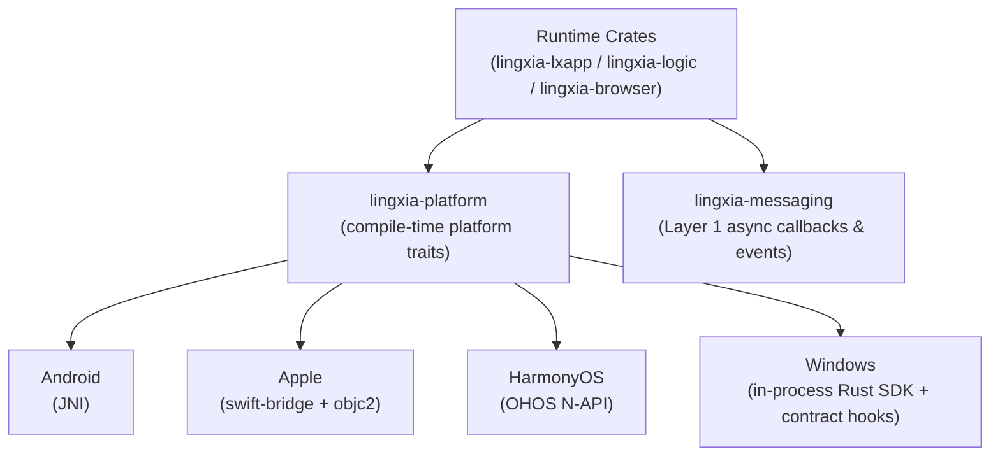

# Platform Abstraction and Cross-Platform FFI

> **Audience**: framework developers and maintainers working on `lingxia-platform`,
> `lingxia-messaging`, platform FFI layers, `lingxia-windows-sdk`, `lingxia-device-io`, or the
> native SDKs (`android`, `apple`, `harmony`). Crate layering rules live in
> [`crate-layout.md`](crate-layout.md).

## 1. Mental Model

LingXia keeps its Rust runtime platform-agnostic by concentrating OS capabilities behind one
compile-time `Platform` implementation in `lingxia-platform`, while each host OS bridges native UI
and system callbacks into Rust using the mechanism native to that platform.

---

## 2. `lingxia-platform` Trait Conventions

Each build compiles one concrete platform (`android`, `apple`, `harmony`, `windows`, or
`unsupported`) implementing one app-runtime supertrait bundle (shell/UI, device/OS services,
media) plus standalone opt-in traits (input/gesture, screenshot, video player).

- **Default-method contract**:
  - Cosmetic host chrome (tray, badge, sidebar actions, shell pins, control indicator) defaults to
    a no-op `Ok` on platforms without that chrome.
  - Hard capabilities (autostart, notifications, banners, browser tab control) default to a
    not-supported error.
- **Runtime capability probing**: OS-version-dependent or policy-dependent capabilities (such as
  macOS autostart or Android badge surfaces) are probed explicitly rather than inferred solely from
  target OS.
- **Notification activation envelope**: Android, HarmonyOS, and Windows share the `lxnotify:v1:`
  URI/launch prefix for notification tap routing; Apple carries the payload in `userInfo`.
- **Windows layer decoupling**: because `lingxia-platform` (Layer 2) cannot depend on
  `lingxia-windows-sdk` (Layer 6), Windows host hooks register into `lingxia-platform` and
  `lingxia-windows-contract` during startup.

---

## 3. `lingxia-messaging` (Layer 1 Contract)

`lingxia-messaging` lives in Layer 1 so platform adapters, runtime crates, and FFI bridges can
exchange async platform results and pub-sub events without circular crate dependencies.

- **Callbacks**: one-shot callbacks auto-remove on first invocation; stream callbacks are bounded
  and auto-clean when closed; synchronous handlers run inside `catch_unwind`. Error results carry
  shared business codes (such as `2000` for user dismissal).
- **Events**: publishing uses non-blocking `try_send` so platform UI threads never stall on slow
  Rust subscribers.

---

## 4. Per-Platform FFI Architectures

| Platform | Bridge Mechanism | Key Bootstrap & Threading Invariants |
| --- | --- | --- |
| **Android** | JNI | `JNI_OnLoad` stores the `JavaVM` across runtime, platform, and WebView layers. Caching Java class global refs **must** run inside the Java → native init call (on the app classloader), never in `JNI_OnLoad` where `FindClass` can fail; failed lookups must clear pending JNI exceptions. Non-JNI Rust threads attach per call. |
| **Apple** | Bidirectional `swift-bridge` + `objc2`/`dispatch2` | Generates two Swift packages: Rust → Swift exports (owning the single shared swift-bridge core runtime) and Swift → Rust callbacks (which strips its duplicate core). |
| **HarmonyOS** | OHOS N-API (`napi-ohos`) | Strict init order: initialize the Rust → ArkTS `ThreadSafeFunction` callback channel and GPU page bridge, require a non-null resource manager, wire surface frame capture, and only then boot the runtime. |
| **Windows** | Pure in-process Rust | Host binaries link `lingxia-windows-sdk` (Layer 6) alongside `lingxia` (Layer 5). `lingxia-windows-contract` (Layer 2) holds the shared host backend trait, chrome renderer, aside-panel state, and DirectComposition surface capture hook (for surfaces invisible to GDI). |

---

## 5. Threading, Feature Tiers, and Boundary Invariants

- **Windows same-thread requirement**: runtime initialization and the Win32 message loop **must**
  run on the **same OS thread**. Taskbar `AppUserModelID` must be stamped *before* any window
  exists so multiple dev-runner instances stay distinct on the taskbar; entering the message loop
  forces Win32 queue creation and records the thread id so exit requests from WebView2 UI threads
  can post `WM_QUIT` cleanly.
- **`lingxia-windows-sdk` feature tiers**:
  - `host-api`: contract-only bring-your-own-host.
  - `components`: embeddable native view components only; deliberately omits the `lingxia` facade,
    default shell, and message loop.
  - `runtime` / `standard`: full host runtime + message loop.
  - `device-frame` is dev-runner only and is never implied by product features like `browser-shell`.
- **Pending WebView surface waits**: repeated layout commits for the same surface overwrite the
  pending placement target so the latest layout wins when the WebView arrives; a wait timeout
  closes any still-live surface record so zombie records cannot stall later plans.
- **`capture-contract` vs `device-io` boundary**:
  - `capture-contract` is traits and value types only (never part of the app-runtime supertrait, no global
    registry, no dummy unsupported provider). Capture authorization (such as Android
    `MediaProjection`) is acquired fresh per session and never cached.
  - `lingxia-device-io` is sessionless desktop OS I/O. Its one-shot `snapshot` feature stays
    visual-only and **never** enables `capture-contract`; realtime capture and persistent
    remote-control supervision are strictly separate opt-in features.
