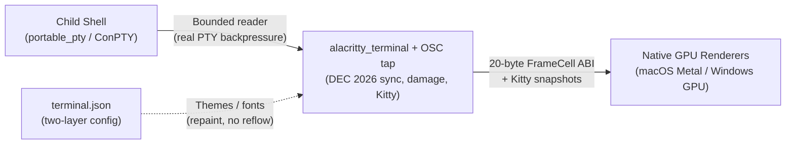

# Terminal Engine and Configuration

> **Audience**: framework developers and maintainers working on `lingxia-terminal`,
> `lingxia-terminal-config`, the `lingxia::terminal` facade, terminal settings control routes, or
> the macOS/Windows native GPU terminal views.

## 1. Mental Model

LingXia's terminal is split cleanly into a headless Rust engine (`lingxia-terminal`), a
non-bricking configuration layer (`lingxia-terminal-config`), and platform-native GPU renderers
(Metal on macOS, wgpu/Direct3D on Windows). The engine owns PTY I/O, VT emulation, Kitty graphics,
and damage tracking; renderers poll flat binary frames over a locked 20-byte cell ABI.

---

## 2. Single-Path PTY and Emulation Contract

- **Single backend**: `portable_pty` owns PTY/ConPTY transport and child I/O; `alacritty_terminal`
  owns the grid, scrollback, and VT parsing (including DEC 2026 synchronized output).
  `lingxia-terminal` never reads user config files.
- **Registry lock discipline**: session id `0` is the error sentinel. Every API call clones the
  session handle out of the global map before locking the session, and writes clone the writer
  queue handle before dropping the session lock.
- **Backpressure & zombie prevention**:
  - The PTY reader pushes into a bounded channel so a slow consumer applies real kernel PTY
    backpressure to the child process.
  - Writes go through a bounded non-blocking queue so UI threads never stall on a wedged PTY.
  - Dropping a session closes the writer queue, kills the child, and waits on it to prevent zombie
    processes.
- **Shell integration**: injected only when the caller supplies no explicit shell args; scripts
  are staged in a per-process temp directory and never mutate user rc files.
- **Process inspection & title polling**:
  - Unix inspects foreground process group and cwd via OS process APIs; Windows reads the child
    PEB `CurrentDirectory` via `NtQueryInformationProcess` + `ReadProcessMemory` (assuming matching
    architecture).
  - Foreground title lookup is debounced and deliberately excluded from the render-rate frame poll
    so OS process inspection never runs at 60/120 Hz.
- **Windows ConPTY redistributable**: pinned by version with SHA-256 verification for both the
  package and extracted binaries (`conpty.dll` + `OpenConsole.exe`).

---

## 3. Renderer Frame Contract and 20-Byte `FrameCell` ABI

- **Cross-language ABI lock**: `#[repr(C)] FrameCell` has a **20-byte stride** (`fg`, `bg`,
  `underline_color`, `text_offset`, `text_len`, `attrs`, `underline`, `columns`) and a fixed
  `attrs` bitfield (`BOLD`, `ITALIC`, `UNDERLINE`, `STRIKE`, `INVERSE`, `DIM`, `HIDDEN`).
  macOS's Metal renderer mirrors this layout in Swift and asserts `stride == 20` on every poll;
  Windows imports it directly. Changing field order, size, or bit positions breaks macOS.
  - `bg` alpha `0` means default background (enabling pane opacity); `columns == 0` marks a
    wide/ZWJ continuation cell.
- **DEC 2026 & damage resync**:
  - While DEC 2026 synchronized output is active, frame and Kitty image polls report `Unchanged`
    until sync ends or expires.
  - If a renderer's `since_generation` does not match the last published generation, the engine
    forces `full_damage = true` so a newly attached or reset renderer never applies a partial diff
    to an unseen frame.
- **FFI pointer lifetime invariant (macOS)**: the FFI frame view returns pointers into the
  session's last-frame buffer that remain valid **only until the next frame poll on that session
  or session close** — Swift must copy them immediately. Process exit is still reported when
  `changed == false` so an idle shell exiting closes the pane.
- **Symbolic colors**: the grid stores symbolic colors and resolves them at frame time against OSC
  overrides and the active theme, making theme switches cheap full-damage repaints with no reflow.
- **Sideband OSC tap**: raw PTY bytes are tapped alongside VT parsing for OSC 7 (cwd), OSC
  9/99/777 (notifications), OSC 9;4 (progress), OSC 133 (command blocks), and Kitty APC `G`.

---

## 4. Kitty Graphics and Restore Snapshots

### Kitty graphics and Unicode placeholders
- Supports the static-image subset (direct/chunked transmit, place, query, delete; zlib,
  RGBA/RGB/PNG) with hard byte, dimension, image, and placement caps.
- Image snapshots advance on the same DEC 2026 boundary as cell frames. Resize or full
  clear-screen clears physical placements while preserving virtual placements and stored images.
- **Unicode placeholder gotcha (`U+10EEEE`)**: placeholder cells encode `image_id` and
  `placement_id` in `fg`/`underline_color` rather than display colors, so frame conversion must
  preserve those raw IDs instead of resolving them through the theme palette.

### Restore snapshots
- Stores plain-text scrollback only (clipped from the oldest side; no VT modes or alt-screen) and
  replays it into a fresh shell with a `Restored` boundary event.
- **Strict version gate**: `version != 1` is rejected rather than best-effort parsed. Crash-safe
  disk persistence and pane layout belong to the host, not `lingxia-terminal`.

---

## 5. Configuration (`terminal.json`) and Control-Surface Boundary

- **Two-layer non-bricking resolution**: framework defaults overlaid with user `terminal.json`.
  Malformed JSON, unknown fields, I/O errors, or out-of-range values never prevent a terminal from
  opening — the loader falls back to defaults and returns a warning.
- **Minimal-diff persistence**: saving writes only keys that differ from defaults (atomically via
  temp file + rename) and **deletes** `terminal.json` when the diff is empty.
- **Separate live generations**: persisted config revisions (for CAS updates) are tracked
  separately from visual-only generations (theme preview, OS appearance) so previews never bump
  persisted revisions.
- **Control-surface rule**: `app.lingxia.terminal-settings` is restricted to host-bundled
  `ControlSurface` sessions on desktop when terminal support is enabled; ordinary apps cannot
  navigate to it, and closing the settings surface automatically releases active theme preview
  leases.
