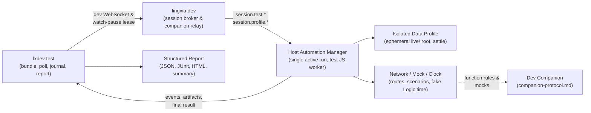

# Test Runner and Automation Runtime

> **Audience**: framework developers and maintainers working on `lxdev test`, `@lingxia/test`, the
> host automation runtime, network interception, isolated data profiles, or device-readiness gates.
> Author-facing testing guides live in [`docs/skill/lxapp/testing.md`](../skill/lxapp/testing.md).

## 1. Mental Model

`lxdev test` runs an lxapp's suite **inside the target host** (phone, desktop app, or Runner)
against the real GPU Views, WebViews, network stack, storage, and timing, while the CLI handles
bundling, session leases, streaming, and reporting.

| Layer | Role |
| --- | --- |
| **`@lingxia/test`** | Authoring API (`test`, `expect`, locators, fixtures), OpenAPI validator, and in-host runner runtime |
| **Host automation runtime** | Raw drivers, run manager, attempt authority, fake clock, isolated data profiles, and display/gesture hooks |
| **Network dev layer** | Route table, scenarios, mocks, call log, wire observer/recordings, and contract capture |
| **`lxdev test`** | Spec bundling and static checks, preset expansion, run polling, event journaling, and report rendering |
| **`lingxia dev`** | Session broker relaying `session.test.*`, holding watch-pause leases, loading mocks, and bridging the companion |

Four architectural principles follow from this split:

- **In-host execution**: the CLI never executes test bodies; specs and their `fetch` calls run in
  the target host's automation JS worker.
- **One active run per host**: a single automation slot is guarded by a controller lease, and the
  dev server pauses file-watch rebuilds while a run is active.
- **Host-owned isolation**: profile switching, network interception, clock faking, and secret
  redaction happen in the host or runner framework, never via test branches inside the app.
- **Fail-closed reporting**: events are persisted before consumption, an abandoned test stops the
  run, and a partial or unrecovered run never passes.

---

## 2. Session Lifecycle, Leases, and Execution Model

### Single active run and watch-pause

- **Slot & controller lease**: the host admits one active run at a time; a concurrent start fails
  with `automation_run_in_progress` (carrying run id, age, and poll gap). Unpolled runs are
  cancelled after a 180 s controller lease so crashed clients cannot wedge the host;
  `--cancel-active` refuses to evict a run polled within the last 15 s.
- **Watch-pause lease**: before bundling, `lxdev test` acquires a `session.watch.pause` lease
  (300 s TTL) from `lingxia dev`, binds it to the run id, and renews it on relayed polls until
  completion or exit/Ctrl-C. While paused, the file watcher accumulates dirty paths and rebuilds
  once after the lease clears; rebuilds and `session.test.start` synchronize under the dev server's
  build and command locks so a run never opens a half-written dev bundle.

### Bundling, selection, and app pinning

- **Static bundling & checks**: `lxdev` collects specs recursively into one JS bundle with a source
  map and a line-offset probe to compensate for engine prologues (e.g., JavaScriptCore's prepended
  `"use strict"`). Static AST checks reject aliased or indirect `test` calls (keeping
  `<file>:<line>` targeting, offline listing, and rerun hints exact) and reject remote `eval(fn)`
  callbacks that close over outer test-file bindings.
- **Selection & ordering**: `session.test.start` separates user `args` (`t.arg()`) from `control`
  filters (`--grep`, `--id`, `--tag` CNF clauses, `--shard`, `<file>:<line>` ranges,
  `--repeat-each`, seeded `--shuffle`). `lxdev test list` runs selection without bodies; `--offline`
  lists statically from the bundle AST.
- **App pinning & recovery**: the runner resolves the subject lxapp once at run start and pins
  every test by appid (never querying "current" again). Before each test and at run end, a missing
  or closed app is reopened and relaunched to its home page, emitting a `recovery` diagnostic
  (`recovery_failed` flags `app_not_live`).
- **Run language**: `control.locale` (`lxdev test --locale`, default `en-US`) opens the host's
  in-memory test-run language layer; while it is open, `lx.host.languagePreference` reads and
  writes that layer, so specs still switch languages. Every terminal transition closes it, and it
  dies with the process, so no run, even one cut off, writes the user's saved preference.

### Interrupted runs and reconnects

A host disconnect while `lingxia dev` relays an active run transitions it to `interrupted_test_run`
with a 30 s grace window (instead of 1 s). Polls during that window receive `runtime_reconnecting`,
journaled by `lxdev` as a pause; a reconnect resumes the run, whereas grace expiry ends the session
and produces a client-side partial report.

---

## 3. Isolation, Deadlines, and Grading

### Shared JS context and per-attempt reclamation

- **Contamination stops the run**: tests execute sequentially in one fresh JS context per run. Once
  any body, cleanup hook, or tracked in-flight fixture call is abandoned, the runner halts the run,
  revokes the context (`E_AUTOMATION_PRIVILEGE` on all driver calls), and marks remaining cases not
  run. One exception: a body that returned with only fixture evals (`t.app.logic.eval`,
  `view.eval`, `page.data`) still running is waited out, since the host times each out at the
  budget it was sent with; that spec fails, the next test starts from a relaunch, and the run
  goes on. Stray assertions from late continuations route to a `late_assertion` diagnostic. Retries
  require a file-scoped `test.reset` hook because new contexts do not reset product state.
- **Attempt authority**: each executed test opens a host attempt token tagging its routes, run
  scenarios, test-clock leases, and opt-in dialog watches. After user `afterEach` and LIFO
  `t.defer`, framework reclamation and the attempt's end strip all attempt-owned resources whether
  or not the body settled; any teardown error stops the run.

### Layered deadlines and run budgets

- **Action vs test deadlines**: locator actions/matchers, `expect.poll`, `t.waitFor`, and
  `t.app.nav` clamp their timeouts to the remaining test (or cleanup) budget minus a reporting
  margin so the action's `TimeoutError` (`E_TIMEOUT`, preserving driver timeout causes) wins over a
  bare test timeout. JS deadlines only stop waiting and cannot preempt blocking native calls; an
  off-worker run deadline and lease interrupt stuck JS and mark a worker wedged after its grace
  period. Timed-out Logic/View evals or page actions force an app relaunch before the next test.
- **Run budget**: without `--timeout-secs`, `lxdev` sends dynamic controls (`budgetPerSpecMs` 30 s,
  `budgetMinMs` 300 s, `budgetMaxMs` 3600 s). The runtime computes
  `min(max, max(min, planned × perSpec))` between tests; exhaustion skips remaining cases with a
  `budget` diagnostic and marks the report partial.

### Grading, locators, and host conditions

- **`test.fail` and `t.skip()`**: `t.skip()` in `beforeEach` or the body grades `skipped` (even
  under `test.fail`) and skips forensics, while in cleanup it fails `defer`. `test.fail` inverts
  body failures; with `expected` (`code` or `message` pattern), only matching failures pass and
  mismatches fail with the expectation attached. Setup failures and timeouts keep their status.
- **Actionability & gestures**: locators require a unique match, enabled/editable state, stable
  geometry, and an unobscured hit point before dispatch, retrying transient page-transition errors
  (`E_PAGE_NOT_ACTIVE`, `E_PAGE_NOT_READY`) and element refusals, but **never** retrying an
  ambiguous input transport failure. Gestures inject timed paths into the host window (Android
  `Instrumentation`, macOS timestamped mouse/scroll events) so native chrome sees real input;
  fallback delivery is recorded in the report.
- **Display & locked screens**: runs keep the display awake on macOS and HarmonyOS. Before each
  test on macOS, a locked screen emits `screen_locked`, skips remaining cases, and marks the report
  partial. Hidden-page visibility and animation-frame checks run only during failure forensics under
  a separate budget.

---

## 4. Isolated Data Profiles

Data isolation, snapshotting, and restoration happen in the host so app code has no test branch and
rollbacks never touch real user data.

- **Process-memory override**: the runtime's data profile redirects an appid's `storage.redb`,
  `userdata`, `usercache`, and `temp` under an ephemeral `live/` root while leaving the bundle and
  shared host stores (`lxapp-index.redb`, downloads, settings) untouched. `checkpoint` and
  `restore` require both an active isolated profile and an active run scope (otherwise rejecting
  with `E_PROFILE_NOT_ISOLATED`).
- **Close → change → reopen → settle**: switches, checkpoints, and restores serialize under one
  lock: retire the app instance, wait for its Logic contexts to hit zero (copying a live `redb` is
  unsafe), copy or swap directories, reopen with prior mode/route, and wait for settle
  (`App.onLaunch` settled, ready current page, no page-instance change for 300 ms).
  `restore(id, { keep })` merges matching `storage.redb` key globs from live storage into the staged
  checkpoint inside that closed window so the app never observes stale values for kept keys.
- **Snapshots & crash hygiene**: seed/export snapshots travel only over `session.profile.*`
  (chunked, offset-checked, SHA-256 verified), never through the artifact channel. Startup sweeps
  orphaned directories under the test-profiles root.
- **Teardown quarantine & `automation_profile_unrecovered`**: the run finishes network/clock
  cleanup and profile teardown *before* publishing a terminal state. If teardown fails, the run ends
  non-success (`internal_error` or augmented failure), the profile enters quarantine, and
  subsequent starts are refused with `automation_profile_unrecovered` while the host retries
  teardown off-thread until clean state is guaranteed.
- **Memory hygiene**: repeated reopens replace hundreds of Logic contexts and WebViews; retired
  pages clear native-held JS roots, WebKit teardown drops user-content handlers/scripts, and
  automation helpers hold the run's shared state weakly so finished runs free promptly.

---

## 5. Network Interception, Fake Clock, and OpenAPI Contracts

### Interception precedence and dual observation

Rust decides under the route table lock; JS executes in the Logic `fetch` and `Rong.SSE` wrappers:

> **Test route** > **Scenario rule** > **Mock selection** (`config` < `baseline` < `dev` < `test:<run>`) → **`mocks/` handler or real network**

- **Fast path & safety**: an atomic active counter lets `fetch` and `Rong.SSE` bypass interception
  with zero overhead when idle. Fulfillments, `patchJson` (RFC 7396 merge patch), `hang` holds, and
  SSE playback enforce domain policy. Dev scenarios and dev mock selections suspend during active
  runs and fail closed on bridge disconnect.
- **Companion coordination**: `function` rules and the Function half of mocks relay through
  `lingxia dev` to the companion, pausing new Logic fetch/SSE admission during scenario transitions
  until HTTP and Function halves both commit (see [`companion-protocol.md`](companion-protocol.md)).
- **Two observation sources**: the Logic wrapper sees all app calls (including routed/mocked ones)
  for failed-test call logs and OpenAPI capture; Rong's wire-level observer sees real network
  traffic across apps, transfers, redirects, and host subsystems for `--record-network`,
  `lxdev network capture` (HAR/JSON), and the live DevTools feed (watch/body calls bypass the
  bridge command queue).

### Fake clock vs captured real timers

- **Logic-scoped fake time**: `LxAppDriver.clock` swaps `Date`, timers, and `performance.now` in
  one app's Logic context only (automation worker, WebViews, and native code keep real time). Fake
  timer IDs start at `0xC0000000` so stale IDs passed to native `clearTimeout` never cancel real
  timers; `tick`/`runAll` settle promises via host executor turns rather than
  `setTimeout(0)`. A 1 s real-time lease poll auto-uninstalls fake time if a run cancels or
  disconnects; dropping pending fake timers forces a relaunch before the next test.
- **Framework timers stay real**: the page runtime captures native `setTimeout`/`clearTimeout` for
  its `setData` debounce before any app code or test clock runs, and the `fetch`/`Rong.SSE`
  wrappers capture real timers at construction so route delays, holds, SSE intervals, and reconnect
  backoff never freeze under fake time.

### OpenAPI contract checking

With `--openapi`, `lxdev` parses OpenAPI 3.0/3.1 documents (rejecting Swagger 2 and non-local
`$ref`s) and sends them to `@lingxia/test`, which validates in-worker with a dependency-free engine
(keeping `expect(v).toMatchSchema()` synchronous and the host schema-free). After each test's
cleanup, captured JSON responses drain past a run-wide watermark: routed/patched mismatches
(`route`, `patch`) fail the case with `ContractError` (`E_OPENAPI_CONTRACT`, phase `contract`)
**before** `test.fail` grading, whereas real-server mismatches emit `contract.warnings` /
`openapi.warnings` and a `contract` diagnostic without failing the case.

---

## 6. Reporting, Shared Suites, Coverage, and Device Readiness

- **Persisted journal & structured reports**: `lxdev` journals every event before consuming it,
  then writes run-level artifacts (`--record-network`, `--profile-save`), reports (`schema_version:
  1` JSON with flat `failures[]`, JUnit XML, HTML, terminal), and `latest` in one fixed order.
  Missing reports, timeouts, cancellations, or disconnects produce a client-side partial report
  (and JUnit run-error testcase) that never passes. `lxdev.json` presets expand before CLI parsing
  with paths anchored to the config directory, and `--last-failed` carries forward prior
  preset/profile flags.
- **Data-level secret masking**: `--secret-arg` values (≥ 4 chars) are masked by `@lingxia/test`
  in events, cases, metadata, and attachments before rendering; credential-named `--arg` keys are
  masked in `meta.args`. `lxdev` also scrubs polled events and withholds any HTML/XML artifact that
  leaks a secret.
- **Shared suites**: cross-target showcase specs live in `@lingxia/test` and are shared across
  WebView and GPU targets via declarative skip lists checked for unused entries and drift.
- **Feature coverage grading**: `--covers-manifest` maps page/app config features and interactive
  View elements against `covers` claims (tracking `not_run` specs and known gaps). Device-run
  grading credits only passed cases that recorded real UI actions or gestures.
- **Device-readiness gate**: readiness runs export a clean commit into an isolated build directory,
  run the showcase's full release suite (plus optional dev-smoke checks) on a real device, and
  archive reports, logs, coverage, and a summary. On Android, a keyguard watchdog unlocks a
  re-locked screen and marks affected cases `lockTainted` so lock failures are not treated as
  product regressions.

---

## 7. Key Invariants to Preserve

- **Never execute test bodies in the CLI**: all spec code, assertions, and `fetch` calls run in the
  target host's automation worker.
- **Never reuse a contaminated context**: any abandoned body, cleanup, or unsettled call revokes
  the context and halts the run.
- **Never copy a live `redb` or touch real data**: profile switches wait for zero Logic contexts,
  and checkpoint/restore require an active isolated profile scope.
- **Never publish completion before teardown**: the run finishes profile teardown (or enters
  `automation_profile_unrecovered` quarantine) before reporting a terminal state or releasing
  watch-pause leases.
- **Never retry ambiguous input dispatch**: check actionability before dispatch; transport errors
  after dispatch may already have triggered UI side effects.
- **Never fake framework timers**: `setData` debounce and network wrapper timers must capture
  native timers before test clocks can install.
- **Never let a partial or leaked run pass**: persist events before consumption, mask secrets at
  the data level, and fail any incomplete run or failed run-level artifact step.
