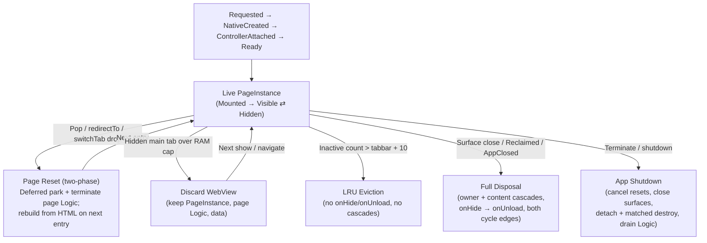

# WebView Lifecycle (Cross-Platform)

> **Audience**: framework developers and maintainers working on WebView creation, security profiles,
> page ownership, presentation, memory reclamation, or teardown across platforms. See
> [`trusted-control-plane.md`](trusted-control-plane.md#ingress-lock-discipline) for ingress lock
> discipline, [`shell-ui-spec.md`](shell-ui-spec.md) for surface presentation and host chrome, and
> [`docs/skill/lxapp/lifecycle.md`](../skill/lxapp/lifecycle.md) for the author-facing hook contract.

## 1. Mental Model

Five ideas govern WebView creation, presentation, and teardown across every platform:

1. **The `lingxia-webview` core is deliberately dumb.** It creates native WebViews, enforces
   security-profile capabilities, normalizes native signals into typed navigation and state events,
   and handles teardown. It knows nothing about hosts, `openURL`, tabs, or
   pages — all navigation, scheme, download, and new-window policy lives in **creator-supplied
   callbacks**. The only scheme the core reserves is `lx-apple` (the Apple bridge transport).
2. **The security profile is the real boundary, not the platform engine.** Three profiles —
   `AppPage`, `BrowserTab`, and `Embedded` — determine bridge installation, storage persistence,
   downloads, dialogs, and navigation rules. Reason about a WebView by its profile, never by
   `WKWebView` vs Android `WebView` vs ArkWeb vs `WebView2`.
3. **`PageInstance` is the unit of app lifecycle.** It wraps a page's view (a shared WebView
   handle for WebView pages or a native endpoint for GPU pages) and owns identity, surface coupling,
   and disposal. App-page hooks (`onLoad` / `onShow` / `onReady` / `onHide` / `onUnload`) fire on
   `PageInstance`, never on the raw WebView.
4. **Visibility comes from the SDK container, not the core.** `onShow` and `onHide` are driven by
   the platform UI layer attaching or detaching the view (`Mounted` / `Visible` / `Hidden`), never
   by `lingxia-webview`.
5. **Teardown is multi-edge and comes in distinct flavors.** `PageInstance` and `WebView` form a
   reference cycle broken by **two** edges (detach drops `Page → WebView`; matched destroy clears
   the delegate `WebView → Page`). Native teardown occurs only when the last WebView handle drops. Reset, eviction, discard, disposal, and app termination are
   distinct operations.

| Layer | Responsibility |
| --- | --- |
| `lingxia-webview` | Generic core: profiles, registry, single-flight creation, event normalizer, platform backends |
| `lingxia-lxapp` | `PageInstance` lifecycle, page maps, surfaces, reset/eviction/discard, shutdown |
| `lingxia-browser` | Browser tabs: tab state and delegate, navigation/download/new-window routing, tab discard ([`browser-runtime.md`](browser-runtime.md)) |
| Platform SDKs | UI containers that attach views, report visibility, and host surfaces ([`shell-ui-spec.md`](shell-ui-spec.md)) |

---

## 2. Security Profiles and WebView Kinds

Profile capabilities live in one Rust rules table. Backends read its fields and never branch on
profile names; Android and Harmony receive the rules inside the create-options
token and reject incomplete tokens so no platform keeps a stale copy.

| Rule | `AppPage` | `BrowserTab` | `Embedded` |
| --- | --- | --- | --- |
| LxApp bridge transport | Installed | **None** | **None** |
| One-way `window.lingxia.postMessage` | No | No | **Yes** (main frame, `<= 64 KiB` JSON) |
| Native-component bridge & baseline CSS | Yes | No | No |
| `lx://` scheme | Served by default | Creator-registered only (none) | Creator-registered only |
| Navigation handler | Optional (`lingxia-lxapp`: allow `lx`/`data`/`blob`, cancel `about:`, forward the rest to the system URL opener) | Optional (web URLs stay in-WebView; external schemes forwarded) | **Required** (creation fails without it; creator judges every top-level load) |
| New window | Creator handler, else dropped | Creator handler (opens managed tab) | Creator handler (default: judge & load in place) |
| Downloads | Rejected at build time | Handed to creator's download flow | Cancelled; the creator's blocked-download callback gets the URL only |
| JS `alert`/`confirm`/`prompt` | Answered without UI | Shown | Answered without UI |
| Website data / DOM storage | Non-persistent; DOM storage off | Persistent, shared across tabs; DOM storage on | Non-persistent (ephemeral); DOM storage on |
| Proxy | Not applied | Applied (or creation fails) | Applied (or creation fails) |
| Document binding (Android/Harmony) | Bound on commit/finish | Proven visible commit only; no Android port | No port exists |

For `BrowserTab` and `Embedded`, the primary security gate is that **no lxapp bridge transport is
installed** on any backend (downstream admission in [`trusted-control-plane.md`](trusted-control-plane.md)
is not enough for untrusted documents).

**WebView kinds**: **LxApp page** (`AppPage`, `PageInstance` delegate, full lifecycle); **Surface
page target** (`AppPage`, isolated `PageInstance` in an overlay/window); **Surface URL target** (no
Rust WebView; the platform surface presenter owns the view, gated by the lxapp's trusted domains);
**Browser tab** (`BrowserTab`, browser tab delegate, no app-page lifecycle; load failures render host HTML at
`about:blank` tracked by delegate state so a user's `about:blank` is unaffected); and **Embedded
`<webview>`** (`Embedded`, child tag with reserved `~child~` segment and no page instance id,
admitting trusted `https://` hosts or single-file `lx://` and torn down with its owning page).

---

## 3. Creation Pipeline and Platform Semantics

### Identity, single-flight, and reuse

Every WebView is keyed in the global registry by `WebTag` (`appid:path[#session]`), isolating
sessions. Core creation advances through `Requested → NativeCreated → ControllerAttached → Ready →
Destroyed`. Creation is strictly idempotent per `WebTag`:
- **No existing instance**: delegate to platform backend creation.
- **Exists, different effective options** (profile, registered schemes, or handler presence):
  **fail** — never silently reuse an incompatible view.
- **Exists, same options, carries any callbacks**: **fail** — callbacks are immutable after first create.
- **Exists, same options, no callbacks**: reuse the existing WebView.

Above core readiness, `lingxia-lxapp` wires the `PageInstance`, creates the page's Logic service,
loads the page HTML, and marks the WebView ready. Browser tabs do not wait on page readiness; they
discard stale async creates by tab creation token ([`browser-runtime.md`](browser-runtime.md)).

### Event normalization and ingress locking

All backends submit raw native signals to a per-WebView event normalizer that delivers correlated
navigation IDs, exactly-once terminals (`Started` → `Succeeded` / `Failed` / `Cancelled`),
coalesced state changes, and flattened FIFO order. Because the normalizer's registry lock is
process-wide and **not reentrant**, ingress checks must obey
[`trusted-control-plane.md`](trusted-control-plane.md#ingress-lock-discipline).

### Platform creation and ready differences

- **Apple (iOS/macOS `WKWebView`)**: dispatches synchronously to the main thread, configures
  `WKWebViewConfiguration` (the `lx-apple` scheme and bridge message handler only for `AppPage`; a
  lifecycle handler for bfcache binding reset), registers the WebView, and reports ready
  immediately. Presentation resolves the webtag to its page instance once; containers reparent and
  report the page shown.
  All Apple builds use **public APIs only** — no private selectors, KVC, or WebKit swizzling
  (`isInspectable` exposes Web Inspector; an injected script reports file-input `accept` filters
  before macOS opens `NSOpenPanel`).
- **Android (`WebView`)**: Rust requests Java creation and awaits one JNI completion (ready or
  failed, answered exactly once). Each load gets a process-monotonic token; `onPageStarted` and
  `onPageCommitVisible` must match it before minting a document generation. On API 23+, an `AppPage` binds a fresh `MessagePort` pair only after a
  matching top-level commit and revokes it on navigation, reload, renderer loss, or teardown
  (`JavascriptInterface` stays `Unproven`; API 21/22 lacks commit callbacks).
- **HarmonyOS (`ArkWeb`)**: two-phase creation. Rust registers the WebView immediately and sends
  the options token to ArkTS to create a `WebviewController`, but readiness completes only when
  ArkUI emits the controller-attached ack (`Web.onAppear` for pages, `Web.onControllerAttached` for
  browser tabs) — the controller-creation call returning does **not** mean ready. Dropping the last
  handle triggers ArkTS destruction and idempotent Rust cleanup.
- **Windows (`WebView2`)**: `AppPage` uses an injected host object and web messages; `about:blank` host HTML
  (load-error pages) loads via `NavigateToString` because `WebResourceRequested` never sees
  `about:blank`. Only `BrowserProcessExited` and `RenderProcessExited` count as document
  termination; GPU/utility/subframe exits and renderer hangs must not invalidate the main document.

---

## 4. Page Ownership, Surfaces, and Lifecycle Dispatch

- **Ownership**: page ownership and path pins follow
  [`lxapp-container.md`](lxapp-container.md#4-page-ownership-navigation-queue-and-stack-rules). An **isolated surface instance** is never
  path-pinned, so an overlay or window at `/home` never replaces a main or tab page at that route.
  Because the opener is awaiting `lx.surface.openPage` on its JS worker, the opener creates the
  isolated page's Logic service first, and WebView setup waits (bounded) for it before loading the
  page HTML so the worker channel cannot deadlock.
- **Page owner and dual surface cascades**: each `PageInstance` records its owner (a page, a
  scene, or the host). Disposal runs two re-entrant-safe cascades: **owner cascade** closes every
  surface this page opened (reason owner-closed, or app-closed on shutdown); **content cascade**
  closes the surface hosting this page and propagates the real reason (e.g. reclaimed) so the
  opener never posts into a dead handle. Surface pages follow **close destroys, hide preserves** (no
  TTL; hidden surface pages are reclaimed only on close or a low-memory signal).
- **Lifecycle clocks and renderer recovery**: `PageInstance` transitions `Created → Mounted →
  Visible ⇄ Hidden → Disposed`, tracking three independent clocks (entry phase, visibility, and
  whether `onReady` has fired). Re-entering a cached instance repeats `onLoad`/`onShow` without repeating
  `onReady`; preloaded tabs stay `Idle` until entered. App hooks run as independent tasks; page
  hooks run serially per page. On renderer termination, Apple reloads the page HTML in place
  (preserving the page's Logic service, Logic `data`, and visibility while replaying `onReady` and clearing dead
  native-component mounts); other platforms run a coalesced session restart back to the initial
  route (never restarting a closed or backgrounded app on a late callback).

---

## 5. Teardown Paths and Memory Reclamation

| Path | `onHide`/`onUnload` | Detach | Surface cascades | Native WebView drop |
| --- | --- | --- | --- | --- |
| Detach | No | — | No | Only if last handle |
| Matched destroy (tag + expected WebView) | No | No | No | When last handle drops (clears delegate & create session) |
| **Page reset** (leaving stack) | `onUnload` on exit | No (parked warm) | No | No |
| **LRU eviction** | **No** | Yes | **No** | Yes |
| **Browser tab / LxApp page discard** | **No** | Yes (lxapp) / No (tab) | **No** | Yes; recreated on activation |
| **Full disposal** | Yes | Yes | Yes (both) | Yes |

### Page reset on leaving the stack (two-phase)

Popping (`navigateBack`), replacing (`redirectTo`), or dropping a pushed page on `switchTab` ends
that page entry while keeping the WebView warm. Reset splits in two halves so off-screen pages
never run mount hooks or queue Logic work speculatively:

1. **Deferred teardown** (delayed 500 ms behind the pop animation): cancels in-flight bridge work,
   resets WebView lifecycle clocks, parks the view on an inert blank document (swallowing
   navigation events), and terminates the outgoing page's Logic service.
2. **Rebuild on next entry** (only when re-entered): creates a fresh page Logic service (restoring
   initial Logic `data`) and, on creation ack, loads the page HTML — **never a WebView reload**. The
   document was installed via HTML string against a logical base URL; `reload()` would refetch raw
   source and lose injected bridge config and nonces.

A per-page transition lock and reset state (pending, awaiting entry, none) serialize the deferred
timer against fast re-entry; entering the page (or in-Logic navigation to it) claims both halves
first. In-Logic navigation and automation evals run **off the worker message pump** so awaiting
page creation or a View round trip never deadlocks queued pump messages.

### LRU eviction and desktop discard

- **LRU eviction**: above tab-bar items + 10 inactive pages, reclaims the oldest page outside the
  protected set (stack, path pins, isolated surfaces; see
  [`lxapp-container.md`](lxapp-container.md#4-page-ownership-navigation-queue-and-stack-rules)) without `onHide`/`onUnload` or surface cascades.
- **Browser tab discard** (desktop): destroys a background tab's WebView while keeping the tab
  state, ID, URL, and sidebar row; stale creates are discarded by creation token
  ([`browser-runtime.md`](browser-runtime.md)) and reactivation reloads the URL.
- **LxApp page discard** (desktop): separate ¼-RAM cap (4–16 live views, ~256 MiB estimate; also
  reclaims eligible pages idle ≥ 10 min) targeting off-stack tab pages of **hidden** mains. Drops
  both the WebView and its create session while keeping `PageInstance`, its Logic service, and
  Logic `data`
  (next show replays `onShow` + `onReady`, not `onLoad`). Policy runs *after* the incoming lxapp is
  shown so arriving tabs are not reclaimed mid-switch.

### Full disposal, capsule close vs termination, and shutdown order

- **Full disposal**: re-entrancy guard → owner cascade → content cascade → `onHide`/`onUnload` →
  detach → cancel view calls → remove from page ownership, path pins, runtime and stack → matched
  destroy → terminate the page's Logic.
- **Capsule close vs termination & admission barrier**: capsule close is a presentation state
  (closed) that may keep Logic alive for recall. Termination permanently retires the
  instance, revokes session API/network access immediately, tears down pages, and drains all queued
  Logic contexts (including queued recreates) so a later open gets a fresh session ID. The
  **admission barrier** (block admission → drain lxapps → resume admission) synchronously blocks
  opens outside a preserved set and stays closed on timeout or cancellation.
- **LxApp shutdown order**: (1) mark the app closing (suppressing per-page Logic termination on
  drop) and clear transient files; (2) cancel pending page resets and **close all surfaces
  (app-closed) before hiding the window**; (3) clear key-event state and hide the window; (4)
  collect all page webtags and WebView handles, cancel view calls, and detach all pages; (5) clear
  page ownership, path pins, runtime records, and chrome layouts (notifying GPU close); (6) run the
  matched destroy for each captured WebView, clear the stack, and terminate the app service.

---

## 6. Key Invariants to Preserve

- **Matched destruction prevents tag-reuse races**: destroy by the captured WebView handle, not by
  tag alone (dropping its create session too) so a delayed teardown never kills
  a replacement sharing the same `WebTag`.
- **Never WebView-reload an `AppPage`**: always reload by loading the page HTML again to preserve
  injected bridge config and nonces.
- **Ingress lock safety**: never re-enter the normalizer's process-wide registry lock on an ingress
  path ([`trusted-control-plane.md`](trusted-control-plane.md#ingress-lock-discipline)).
- **Off-pump Logic waits**: keep in-Logic navigation and automation evals off the worker message
  pump so awaited page creation and View round trips cannot wedge the context.
- **Android retained GPU pages & cold-start gate**: hide a cached GPU page's `SurfaceView` when
  paused or obscured so it cannot cover a newly selected tab; gate cold-start first draw until the
  home page is first ready, with timeout release and detach cleanup (never on warm launches).
- **Apple public API only**: zero `_`-prefixed selectors, undocumented KVC, or WebKit swizzling in
  any build.
